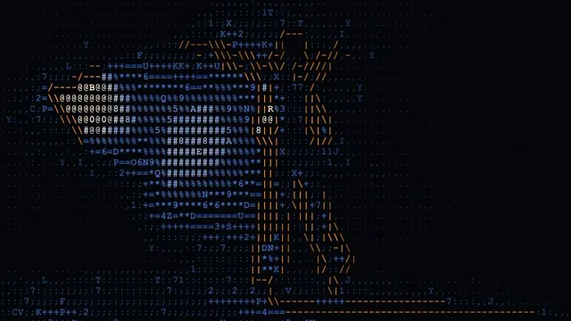

# ASCII

**New to ASCII art?** It draws a picture with nothing but text characters. Each character
stands in for a small patch of the picture: characters with a lot of ink (`@`, `#`) for bright
patches, sparse ones (`.`, `:`) for dim ones, so from a step back the text reads as the picture.
It goes back to printers and terminals that could show nothing but text, and lives on as a
retro, hacker look.

This effect does it live, to any picture or video, as a grid of glyph cells. Where the picture
has a clear edge, the cell gets the line glyph that follows it ( `|` `\` `-` `/` ), so outlines
stay readable. Everywhere else a glyph from a brightness ramp fills in the tone, and dark cells
stay empty. It is good for music visuals, title cards and anything that should look like a
terminal. Most ASCII shaders map brightness to glyphs and nothing else. This one also follows
edges and reacts to music, with extra moments from
[Fosfora](https://github.com/kevinraymond/fosfora)'s signal. It is all GLSL and TouchDesigner
operators, so it runs on any GPU TouchDesigner supports, on Mac and Windows.

**[Download ascii.tox](https://github.com/kevinraymond/touchdesigner-effects/releases/latest/download/ascii.tox)**
· saved in TouchDesigner 2025.33230 (older builds may not open it) · works on the free
Non-Commercial license

## Use it

1. Drag `ascii.tox` into your network. It shows a sample picture straight away.
2. Wire any TOP into input 1. The result is on output 1, at the input's size.
3. Optional: wire audio or beat channels into input 2 (see Audio input).

Open Window (on the effect's page) shows it full size; Esc closes the window.

To update, delete your copy and drag in the new `ascii.tox`. Dragging a `.tox` in embeds a copy,
so a new release doesn't reach it on its own. You can also point the COMP's External .tox at a
downloaded file.

## Parameters

The ASCII page, top to bottom:

| Parameter | Default | What it does |
|---|---|---|
| Font | System Font | System Font draws the glyphs with a font installed on your computer, at run time. Bitmap 5x7 is a pixel font drawn for this library, the same on every computer. |
| Font Name | Courier New | The system font, by name. A monospaced font keeps glyphs centered. Courier New is on Mac and Windows; Menlo, Consolas and Andale Mono work too. If the font is missing, TouchDesigner uses Helvetica and shows a warning. Grayed out for Bitmap 5x7. |
| Cell Size | 18 | Height of a glyph cell in pixels, 6 to 48. The width is about 0.55 of it. Bitmap 5x7 snaps to whole font pixels: 9, 18, 27, 36, 45. |
| Glyphs | Symbols | The glyphs for brightness: Symbols ( `. , : ; + = * % # @` ), Digits or Letters. Each set runs from light to heavy ink. |
| Edges | 0.5 | How readily outlines become line glyphs. 0 turns them off: only the brightness ramp. |
| Color | Orange and Blue | Orange and Blue: outlines orange, fill blue, turning pale in the brightest parts. Source: each glyph in its cell's color. Mono: every glyph in Ink. |
| Ink | 1, 0.72, 0.42 | The glyph color for Mono. Grayed out for the other colors. |
| Black Point | 0.06 | Cells darker than this stay empty. Raise it to clear noise out of dark footage. |
| Gamma | 0.8 | Below 1 brings up the midtones (more, heavier glyphs in dim areas); above 1 pushes them down. |
| Auto Levels | On | Stretches dim pictures so their brightest parts reach the heaviest glyphs. It eases over half a second, so a sudden highlight never makes the picture jump. |
| Backdrop | 0 | How much of the picture, dimmed, shows behind the glyphs. 0 is a dark ground. |
| Beat Pop | 0.5 | A contrast jump on every bar (or beat) from input 2. It is a flash, so Flashing limits how often it comes. 0 turns it off. |
| Pop On | Bars | Pop on every bar or every beat. Grayed out while Beat Pop is 0. |
| Beat Glyphs | 0.3 | Share of the cells that switch to another glyph set on every beat, settling back over 0.3 s. 1 swaps the whole set. |
| Loudness | 0.5 | How much loudness brings out more outlines. |
| Fosfora Moments | On | Sections, builds and drops from Fosfora's signal (see Audio input). Other inputs have none of these. |
| Flashing | Calm | Off never flashes. Calm allows at most one flash a second. Up to 3 per second is the WCAG 2.3.1 limit. |
| Open Window | | Shows the picture in its own window, 1280 x 720 or filling a display. |
| Full Screen | Off | Opens the window filling the whole display, for a projector or a second screen. |
| Display | 0 | Which display the window opens on; 0 is the primary display. |

The About page has Version, Built With (the TouchDesigner build it was saved in) and Open Docs.

## Audio input

**[Fosfora](https://github.com/kevinraymond/fosfora)** gives the most. Run `fosfora --signal`,
drag `fosfora_signal.tox` (in Fosfora's `integrations/touchdesigner/`) into your project, and wire
it into input 2. With Fosfora Moments on, you get:

- **Bars:** the contrast pops land on Fosfora's real downbeats.
- **Sections:** each new section moves the whole picture to the next glyph set (Symbols, then
  Digits, then Letters).
- **Builds:** as a build rises, the black point drops and more cells count as outlines, so the
  dark areas fill in with glyphs. After the drop it eases back over 1.5 s.
- **Drops:** a drop gives one reverse-video flash: each glyph cell turns solid in its ink color,
  with the glyph cut out of it. It shares the flash budget with the pops, so Flashing still limits
  it. Fosfora's drop detection is experimental.

**Plain audio** works too. Wire an Audio File In or Audio Device In CHOP into input 2. The effect
takes the loudness of the low band (30 to 150 Hz) as the level, and a sudden jump in it as a beat.
That beat detector is simple and experimental: it can add or miss beats in busy music. Bars come
every 4 beats, counted from when it starts.

**TouchDesigner's audioAnalysis** (or any CHOP with these channels) works the same way. Beats come
from `beat_count`, or from the rising edge of `beat`, `kick` or `onset`. The level comes from
`energy`, `level`, `low`, `bass` or `rms`.

With any of these inputs:

- every beat moves a share of the cells to another glyph set with the same ink (Beat Glyphs);
- every bar, or every beat, gives a contrast pop (Beat Pop and Pop On);
- loudness brings out more outlines (Loudness).

**Nothing wired:** no beats and no pops. The effect still draws the picture.

## Performance

60 fps at 1280 x 720 on the reference machine (MacBook Pro, Apple M2 Pro, 16 GB, macOS 15.6,
TouchDesigner 2025.33230), with default parameters. Each frame took 1.09 ms on the GPU (95th
percentile 1.33 ms) and 0.42 ms on the CPU (95th percentile 0.48 ms), and TouchDesigner held
60 fps.

The edge pass runs at half resolution. The costliest steps are the narrow blur (0.40 ms), the
render (0.22 ms) and the cells pass (0.22 ms). Smaller cells add work to the cells pass, which
takes 16 color samples per cell. A larger input costs more everywhere. Nothing inside cooks while
the output is unused.

## Accessibility

- **Not by hue alone.** In Orange and Blue, outlines are orange and the fill is blue. Outlines
  also have their own shapes (`|` `\` `-` `/`) and are drawn brighter. In every color mode,
  brightness follows the picture, so Source and Mono show the same structure.
- **Colorblind-safe palette:** orange and blue.
- **Legible text.** At the default Cell Size of 18, the system font is drawn at 16 px, and Bitmap
  5x7 at 2 screen pixels per font pixel. Smaller cells trade legibility for detail.
- **Flashing.** The contrast pops and the drop's reverse video are flashes. They pass through one
  gate that follows the Flashing parameter: Off never flashes, Calm (the default) allows at most
  one flash a second, and Up to 3 per second is the WCAG 2.3.1 limit, which no setting exceeds.
  Glyph swaps keep the same ink, so they are not flashes. Builds and loudness change the picture
  gradually.

The flash rates were measured, not assumed. The test recorded the output while it fed a beat far
busier than music: 8 beats, 2 bars and 1 drop a second, a section change every 2 s, and a build
rising and falling. The table gives the flashes in the worst second, by WCAG's area rule:

| Clip | Off | Calm | Up to 3 per second | The clip alone |
|---|---|---|---|---|
| Dancer in a hazy warehouse | 0.0 | 1.0 | 2.0 | 1.0 |
| People crossing a plaza | 0.0 | 1.0 | 2.0 | 0.5 |

There were no red flashes. On the plaza clip, Calm's 1.5 includes the footage's own 0.5.

## Experimental

- Drop moments depend on Fosfora's drop detection, which is experimental.
- Beats from raw audio come from a simple kick detector. It can add or miss beats; Fosfora or
  audioAnalysis give steadier beats.

## Credits and license

MIT. The shaders and operators are written for this library.

- **Edge glyphs** follow the approach Acerola showed in "I Tried Turning Games Into Text" (YouTube,
  2024): a difference of Gaussians finds the edges, a Sobel filter (Sobel and Feldman, 1968) gives
  their direction, and each cell takes the line character of the direction most of it points.
  Followed, not copied.
- **Glyphs by ink:** brightness maps to how much ink a glyph carries, as ASCII art always has.
- **Dice:** MurmurHash3's 32-bit finalizer (Austin Appleby, public domain).
- **Fonts:** the 5 x 7 bitmap font was drawn for this library. The system font is your own: the
  effect draws it at run time, and no font ships in the `.tox`.
- **Read during the survey, not used:** Lou Evoy's ASCII TOP (paid, NVIDIA only), uisato's ASCII
  Paradise (paid).
- **Flash limits:** [WCAG 2.3.1](https://www.w3.org/WAI/WCAG22/Understanding/three-flashes-or-below-threshold.html), measured with this library's tools (`dev/flash.py`, `dev/flashcount.py`).

Preview footage: Kevin Raymond, touchdesigner-effects,
[CC BY 4.0](https://creativecommons.org/licenses/by/4.0/). It is AI-generated (see the
[repository README](../../README.md#demo-footage)) and shows no real person.
