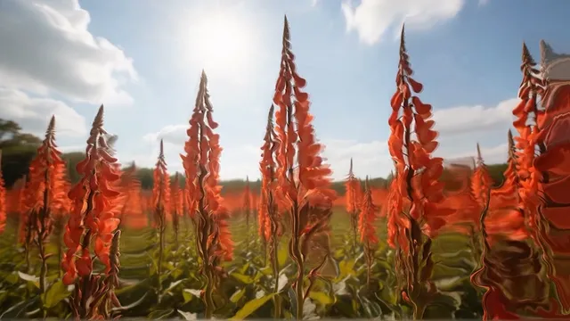

# Datamosh

**New to datamoshing?** It is a glitch-art technique that breaks video compression on purpose. To
save space, a compressed video stores a full picture (a keyframe) only now and then; the frames in
between store mostly how patches of the picture move. Delete the keyframe at a cut, and the new
shot's motion gets applied to the old shot's picture: the old shot smears and melts into the new
one until the next keyframe cleans it up. It has been a music-video staple since the late 2000s.

This effect imitates that look live, on any moving picture. It does not edit a real compressed video
and deletes no real keyframes. Instead it estimates the motion itself on the GPU, every frame, and
runs its own small "decoder" that it holds back from correcting. Use it for music visuals,
transitions between shots, or any moving picture you want to melt. TouchDesigner's own Optical Flow
TOP runs only on Windows with an NVIDIA RTX card. This effect does its own motion estimation in
GLSL, so it works on a Mac too. It reacts to music, with extra moments from
[Fosfora](https://github.com/kevinraymond/fosfora)'s signal.

**[Download datamosh.tox](https://github.com/kevinraymond/touchdesigner-effects/releases/latest/download/datamosh.tox)**
· saved in TouchDesigner 2025.33230 (older builds may not open it) · works on the free
Non-Commercial license

## Use it

1. Drag `datamosh.tox` into your network. With nothing wired in, it cuts between two of
   TouchDesigner's sample pictures every 6 seconds, so there is a cut to mosh straight away.
2. Wire any TOP into input 1. The result is on output 1, at the input's size. Moving pictures and
   hard cuts mosh best.
3. Optional: wire audio or beat channels into input 2 (see Audio input).

A clip slower than the project, such as 16 fps footage in a 60 fps project, works as it should:
the picture moves only when the input brings a new frame, so the smear doesn't pulse.

Open Window (on the effect's page) shows it full size; Esc closes the window.

To update, delete your copy and drag in the new `datamosh.tox`. Dragging a `.tox` in embeds a
copy, so a new release doesn't reach it on its own. You can also point the COMP's External .tox
at a downloaded file.

## Parameters

The Datamosh-style page, top to bottom:

| Parameter | Default | What it does |
|---|---|---|
| Mode | Smear | How the picture moves. Smear: optical flow per pixel, so the smears look liquid. Blocks: one motion vector per 16 px block, as a codec finds them, with a coarse residual and frozen blocks. Switching modes doesn't jump: both work on the same picture. |
| Mosh | 0.5 | How much of each new frame's correction the picture leaves out. At 0 every correction arrives, so it moshes only at cuts, skips, Hold, or with Motion away from 1. At 1 the motion alone moves the picture, and only Recovery brings it back. |
| Motion | 1.2 | How far each frame's motion pushes the picture. Above 1 it runs ahead of the movement and smears. Below 1 it lags behind. |
| Recovery | 3 | Seconds the picture takes to fade back to the input after a mosh. Longer keeps smears around. |
| Chroma | 0 | Lets color smear apart from brightness. At 1, brightness follows the input and only color moshes. |
| Frozen Blocks | 0.03 | Blocks only: the share of blocks that miss each update and stay where they were. More freeze during a skipped keyframe. Grayed out in Smear. |
| Hold | Off | Freezes the motion and keeps applying it, with no corrections. What was moving keeps flowing the same way (the "bloom" mosh), and what was still stays put. When Hold goes off, the picture recovers. |
| Mosh Cuts | On | At a cut in the input, drops the keyframe: the new shot's motion pushes the old picture around until it recovers. Off: cuts pass through. Cut detection is experimental (see below). |
| Keyframe | | Sends a keyframe: the picture fades back to the input over Fade. In Blocks it fades in a sweep of block columns, left to right. It counts as a flash, so Flashing limits it, and it does nothing when Flashing is Off. |
| Fade | 1 | Seconds a keyframe takes to fade the picture back to the input. |
| Skip Keyframe | | Skips a keyframe now. For about half a second the motion holds and no corrections arrive, so the picture smears along its last movement, then recovers. It counts as a flash, so Flashing limits it, and it does nothing when Flashing is Off. |
| Skip On | Every Bar | Which pulse on input 2 skips a keyframe, as Skip Keyframe does: Every Beat, Every Bar (Fosfora's downbeats, else every 4th beat), or Off. Flashing limits it too. Beats found in raw audio are experimental. |
| Level | 0.3 | How much loudness on input 2 adds to Mosh. Louder passages smear more. |
| Song Structure | On | With Fosfora's signal on input 2: builds, drops and sections (see Audio input). Other inputs carry no song structure, so this does nothing with them. |
| Flashing | Calm | Off never flashes. Calm allows at most one flash a second. Up to 3 per second is the WCAG 2.3.1 limit. |
| Open Window | | Shows the picture in its own window, 1280 x 720 or filling a display. |
| Full Screen | Off | Opens the window filling the whole display, for a projector or a second screen. |
| Display | 0 | Which display the window opens on; 0 is the primary display. |

The About page has Version, Built With (the TouchDesigner build it was saved in) and Open Docs.

## Audio input

**[Fosfora](https://github.com/kevinraymond/fosfora)** gives the most. Run `fosfora --signal`,
drag `fosfora_signal.tox` (in Fosfora's `integrations/touchdesigner/`) into your project, and wire
it into input 2. With Song Structure on, you get:

- **Builds:** as a build rises, keyframes are withheld. Recovery slows to a stop and Mosh climbs
  toward 0.9, so the picture melts further and further.
- **Drops:** the drop brings a keyframe that fades the picture clean over Fade. Fosfora's drop
  detection is experimental.
- **Sections:** each new section brings a keyframe too.
- **Bars:** with Skip On at Every Bar, the skips land on Fosfora's real downbeats.

**Plain audio** works too. Wire an Audio File In or Audio Device In CHOP into input 2. The effect
takes the loudness of the low band (30 to 150 Hz) as the level, and a sudden jump in it as a beat.
That beat detector is simple and experimental: it can add or miss beats in busy music. Bars come
every 4 beats, counted from when it starts.

**TouchDesigner's audioAnalysis** (or any CHOP with these channels) works the same way. Beats come
from `beat_count`, or from the rising edge of `beat`, `kick` or `onset`. The level comes from
`energy`, `level`, `low`, `bass` or `rms`.

With any of these inputs:

- every beat or every bar skips a keyframe (Skip On), so the picture smears along its movement
  for a moment;
- loudness adds to Mosh (Level).

**Nothing wired:** no skips, and Level adds nothing. The effect still moshes the input's cuts and
its own Mosh, and the Keyframe and Skip Keyframe pulses still work.

## Performance

60 fps at 1280 x 720 on the reference machine (MacBook Pro, Apple M2 Pro, 16 GB, macOS 15.6,
TouchDesigner 2025.33230), with default parameters (Smear). Each frame took 2.84 ms on the GPU
(95th percentile 4.36 ms) and 0.36 ms on the CPU (95th percentile 0.48 ms), and TouchDesigner
held 60 fps.

The optical flow is most of it: Lucas-Kanade at 1/4 size (1.15 ms) and at 1/8 (0.56 ms), then
the decoder (0.61 ms). Blocks costs a little more: 3.44 ms on the GPU (95th percentile 4.99 ms)
and about 0.7 ms on the CPU. The costliest Blocks step picks the best offset per block
(about 1.4 ms). A larger input costs more everywhere; Mosh, Motion and the other settings cost
nothing extra.

With nothing downstream and the node out of view, nothing inside cooks, whether input 2 is
wired or not.

## Accessibility

- **Not by hue alone.** The effect draws nothing of its own: no overlay, no colors, no text. It
  moves the input's own pixels. Chroma lets color smear apart from brightness, but carries no
  meaning.
- **Palette:** none; the picture keeps the input's colors.
- **Flashing.** Keyframes and skipped keyframes change the whole picture, so they count as
  flashes. They pass through one gate that follows the Flashing parameter. Off lets none through:
  no skips on beats, no keyframes from Fosfora's drops and sections, and the Keyframe and Skip
  Keyframe pulses do nothing. Calm (the default) allows at most one keyframe and one skip a
  second, and Up to 3 per second is the WCAG 2.3.1 limit, which no setting exceeds. Even then,
  nothing changes suddenly: a keyframe fades over Fade (at least 0.25 s), a skip smears the picture
  along its own motion, recovery fades, and a cut in the input is held rather than passed through.

The flash rates were measured, not assumed. The test recorded the output while it fed a beat far
busier than music: 8 beats, 2 bars and 1 drop a second, a section change every 2 s, and a build
rising and falling. The gate did pass them: in 3 s, Calm let through 3 skips and 3 keyframes,
Up to 3 per second 6 skips and 3 keyframes, and Off none. The table gives the flashes in the worst
second, by WCAG's area rule:

| Clip | Off | Calm | Up to 3 per second | The clip alone |
|---|---|---|---|---|
| Dancer in a hazy warehouse | 0.5 | 1.0 | 1.0 | 1.0 |
| People crossing a plaza | 0.5 | 0.5 | 0.5 | 0.5 |

The settings barely differ because the keyframes and skips fade instead of flashing: no setting
measured more than the clip does by itself. There were no red flashes.

## Experimental

- Cut detection is a heuristic. A cut is a change between frames several times larger than the
  usual one, and never less than a fixed floor. It can miss a soft cut, or take a sudden change of
  light in the input for a cut. Mosh Cuts turns it off.
- Drop keyframes depend on Fosfora's drop detection, which is experimental.
- Beats from raw audio come from a simple kick detector. It can add or miss beats; Fosfora or
  audioAnalysis give steadier beats.

## Credits and license

MIT. The shaders and operators are written for this library. The optical flow follows
B. D. Lucas and T. Kanade, "An Iterative Image Registration Technique with an Application to
Stereo Vision" (1981). The block matching is the standard full search an encoder does, refined
to a quarter pixel as in H.264. Resampling uses a Catmull-Rom bicubic, clamped so repeated moves
neither blur nor ring. The per-block dice roll uses the "lowbias32" integer hash from Chris
Wellons' [hash-prospector](https://github.com/skeeto/hash-prospector) (public domain, the
Unlicense). With nothing wired in, it shows TouchDesigner's own sample media; none ships in the
`.tox`.

Preview footage: Kevin Raymond, touchdesigner-effects,
[CC BY 4.0](https://creativecommons.org/licenses/by/4.0/). It is AI-generated (see the
[repository README](../../README.md#demo-footage)) and shows no real person.
