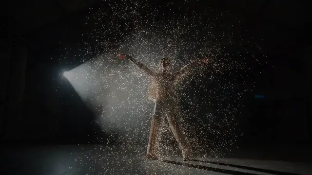

# Depth Particles

**New to depth-driven particles?** A depth map is a picture of how far away things are: brighter
is nearer. Depth cameras such as the Kinect and the RealSense make one live, and depth estimators
such as Depth Anything make one from any video. From the depth, an effect can tell a person from
the room behind them and do something to just the person. This one sends particles off them, like
smoke or sparks: the look of interactive installations and concert visuals where the dancer seems
to shed light.

This effect finds the people in a depth map (or a mask) and sends particles off them, each in the
picture's color where it was born. The air carries them up and swirls them around, and they fade
over a few seconds. The music moves the whole cloud: loudness thickens and thins the stream, every
beat fires a burst and kicks the cloud outward from the people, and every bar swings the wind to a
new direction. With Fosfora's signal, a build stirs up the air and a drop sends a shockwave out. It finds people by how they stand out from what
lies beside them, not by a plain distance threshold, so the floor and walls stay out without any
setup, even with a moving camera. The free route so far was wiring the Palette's particlesGpu by
hand from a Kinect tutorial; this takes any depth or mask TOP (a Kinect's, a RealSense's, a depth
estimator's) and is one MIT `.tox`, up to 65,536 particles on the GPU.

**[Download depth_particles.tox](https://github.com/kevinraymond/touchdesigner-effects/releases/latest/download/depth_particles.tox)**
· saved in TouchDesigner 2025.33230 (older builds may not open it) · works on the free
Non-Commercial license

## Use it

1. Drag `depth_particles.tox` into your network. It shows TouchDesigner's sample movie (a white
   birch among dark leaves) with particles peeling off the trunk straight away: with nothing on
   input 3, the picture's brightness stands in for depth.
2. Wire your picture into input 1. The result is on output 1, at the input's size.
3. Wire its depth map or a mask into input 3: grayscale, brighter nearer (or inside), lined up with
   input 1. Without it, input 1's brightness stands in, so bright things that stand out from what is
   beside them emit. That works for a lit figure on a dark stage, and finds lamps and haze too.
4. Optional: wire audio or beat channels into input 2 (see Audio input).
5. Set Show to People to see what the effect takes for the people, and tune Find, Stand Out and Far
   Limit until it is just them.

Open Window (on the effect's page) shows it full size; Esc closes the window.

To update, delete your copy and drag in the new `depth_particles.tox`. Dragging a `.tox` in embeds a
copy, so a new release doesn't reach it on its own. You can also point the COMP's External .tox at a
downloaded file.

### Depth sources

- **Depth estimators** (Depth Anything and the like, run on a recording or live): brighter is
  nearer, so leave Polarity on Brighter Is Nearer. Pick a video model or one that normalizes the
  whole clip at once: a model that stretches every frame to its own range makes the depth pump as
  people move, and the particles jump with it.
- **Kinect:** its depth image is brighter nearer.
- **RealSense** (the RealSense TOP, Windows only: TouchDesigner has none on Apple Silicon): its
  Depth output is darker nearer, and black means the camera got no reading there. Set Polarity to
  Darker Is Nearer: the effect flips it and leaves the black out, so holes in the depth never turn
  into the nearest thing in the room.
- **A mask** (white inside the person, black outside, from any segmentation tool): Find on Stand Out
  works, and Nearer Than Far Limit keeps people who touch the edge of the frame.
- **A plain webcam:** estimate depth or a person mask live, then wire it into input 3. Each of
  these needs its own install (a Python environment, a model download or a plugin), which is why
  none can come inside this `.tox`:
  - Derivative's [TDDepthAnything](https://github.com/TouchDesigner/TDDepthAnything) runs Depth
    Anything inside TouchDesigner (PyTorch, through TDPyEnvManager);
    [olegchomp's version](https://github.com/olegchomp/TDDepthAnything) runs it with TensorRT on
    Windows and NVIDIA, and [appletd](https://github.com/ojrgb/appletd) runs Apple's Vision models on
    macOS. Check each one's model license if your work is commercial.
  - [MediaPipe for TouchDesigner](https://github.com/torinmb/mediapipe-touchdesigner) (MIT, Mac and
    Windows) gives a person mask; on Windows with an NVIDIA RTX card, so does TouchDesigner's own
    NVIDIA Background TOP. Set Find to Nearer Than Far Limit for a mask.
  - With none of them, input 1's brightness stands in: fine for a lit performer on a dark stage,
    poor in an ordinary room.
- **Two movie files** (a recording and its depth): make the depth show the recording's frame, or the
  two drift apart whenever the recording plays without the effect (when it also feeds something
  else). Set the depth's Movie File In to Play Mode Specify Index, Index Unit Indices, and its Index
  to an Info CHOP on the recording's Movie File In: `op('info1')['index']`.

### How it finds people

Find on Stand Out counts what is nearer than Far Limit and nearer, by at least Stand Out, than
something to its left and something to its right in the same row. A floor is about as near all
along a row, and a wall gets steadily nearer or farther along one, so neither passes; a person has
background on both sides. It needs no picture of the empty room, so it works with a moving camera.
Far Limit then drops whatever stands out but is far away, such as beams overhead or a stand at the
back.

Two things it can't tell: someone cut off by the left or right edge of the frame has nothing beside
them on that side and drops out, and feet merge with the floor they stand on. For a depth camera
mounted so that it doesn't see the floor, or for a mask, Find on Nearer Than Far Limit counts
everything nearer than Far Limit.

## Parameters

The Depth Particles page, top to bottom:

| Parameter | Default | What it does |
|---|---|---|
| Show | Particles | Particles: the effect. People: what the effect takes for the people, in orange, and the depth beside them in blue, over the dimmed picture, for tuning the next four. |
| Find | Stand Out | How the people are found in the depth: Stand Out or Nearer Than Far Limit (see How it finds people). |
| Stand Out | 0.08 | How much nearer than what lies to its left and right something must be to count as a person, as a share of the depth range (0 to 0.3). Grayed out unless Find is Stand Out. |
| Far Limit | 0.5 | Anything farther than this is never a person, from 0 (farthest) to 1 (nearest). Raise it to drop the background; lower it if parts of people go missing. |
| Polarity | Brighter Is Nearer | Which way the depth runs. Darker Is Nearer is for the RealSense TOP, whose black (no reading) is then left out. |
| Emit From | Body | Where particles are born: anywhere on the people, or only along their outline. |
| Rate | 5000 | Particles born per second, 0 to 30,000. At most 65,536 are alive at once. |
| Life | 2.5 | How long a particle lives, in seconds. Each lives between half and one and a half times this. |
| Size | 3 | Size of a particle in pixels at 720 high; it scales with the picture. |
| Speed | 0.15 | How fast particles leave the body, in frame heights per second. |
| Drift | 0.1 | How fast the air carries particles up, in frame heights per second; below 0 it carries them down. |
| Turbulence | 0.5 | How much the air swirls the particles around. |
| Color | Picture | The picture's color where each particle is born, lifted so dark clothes still glow, or orange, blue or white. |
| Glow | 0.5 | How much the particles glow around themselves. |
| Backdrop | 0.6 | How bright the picture behind the particles is, from 0 (black) to 1. |
| Loudness | 0.7 | How much the loudness of input 2 thickens and thins the stream. At 1, quiet passages emit a third of Rate and the loudest a fifth more; 0 keeps Rate steady. |
| Beat Bursts | 0.5 | On each beat of input 2, a burst of particles leaves the body, up to three times as fast as the rest, and the whole cloud is kicked outward from the people; 0 for neither. |
| Bar Gusts | 0.5 | On each bar of input 2 (every 4 beats when it has no bars), the wind swings to a new direction, up to about 35 degrees from straight up at 1, and eases there over 0.6 s; 0 keeps it blowing straight. |
| Song Moments | On | With Fosfora's signal on input 2: a build stirs the air up as it rises, and a drop sends a shockwave out from the people. |
| Open Window | | Shows the picture in its own window, 1280 x 720 or filling a display. Esc closes it. |
| Full Screen | Off | Opens the window filling the whole display, for a projector or a second screen. |
| Display | 0 | Which display the window opens on; 0 is the primary display. |

The About page has Version, Built With (the TouchDesigner build it was saved in) and Open Docs.

## Audio input

**[Fosfora](https://github.com/kevinraymond/fosfora)** gives the most. Run `fosfora --signal`, drag
`fosfora_signal.tox` (in Fosfora's `integrations/touchdesigner/`) into your project, and wire it
into input 2. Its loudness thickens and thins the stream (Loudness), every beat fires a burst and
kicks the cloud outward (Beat Bursts), every bar swings the wind (Bar Gusts), and with Song Moments
on:

- **Builds:** the air swirls harder as a build rises, up to three times Turbulence, and calms over
  the two seconds after it.
- **Drops:** a ring leaves the people's middle and sweeps outward across the frame in 1.2 s,
  shoving the particles it passes. Fosfora's drop detection is experimental.

**Any input:** loudness, beats and bars do the same. Raw audio (an Audio File In or Audio Device In
CHOP) gives beats from a simple kick detector and a bar every 4 beats; its loudness is measured
against its own recent peak, so the stream follows the music's swells rather than its overall volume.
TouchDesigner's audioAnalysis gives beats from its kick or onset channels and loudness from its
energy.

**Nothing wired:** a steady stream at Rate, the wind straight up, no bursts.

## Performance

60 fps at 1280 x 720 on the reference machine (MacBook Pro, Apple M2 Pro, 16 GB, macOS 15.6,
TouchDesigner 2025.33230), with default parameters, a depth clip on input 3 and a beat far busier
than music on input 2. Each frame took 2.4 ms on the GPU (95th percentile 2.8 ms) and 0.8 ms on the
CPU (95th percentile 1.1 ms). Most of it is drawing: 0.9 ms to draw the particles, 0.5 ms to blur
their glow and 0.5 ms to lay them over the picture; moving them takes about 0.4 ms, and finding the
people about 0.3 ms, on a 320 x 180 copy of the depth whatever its size. Rate and Life barely change
the cost: every one of the 65,536 particles is moved and drawn every frame, alive or not, and at Rate
30,000 with Life 4 a frame took 2.4 ms on the GPU. A larger picture costs more to draw and blur.
Nothing inside cooks while the output is unused.

## Accessibility

- **No flashing.** Particles fade in over a tenth of a second and out over the second half of their
  lives, and the music moves particles and adds them rather than lighting the picture, so the effect
  has no Flashing setting. The test below confirms it.
- **No meaning in color.** Particles take the picture's colors or one color, as decoration. The
  People view marks the people in bright orange and the depth beside them in dim blue, so brightness
  tells them apart as well as hue.

The flash rates were measured, not assumed. The test recorded the output while it fed a beat far
busier than music: 8 beats, 2 bars and 1 drop a second, so a shockwave every second. The table gives
the flashes in the worst second, by WCAG's area rule:

| Clip | The effect | The clip alone |
|---|---|---|
| Dancer in a hazy warehouse, with her depth | 1.0 | 1.0 |
| Hands against black, with their depth | 0.5 | 1.5 |
| Dancer in a hazy warehouse, with her depth, no beat | 0.5 | 1.0 |

Never more than the footage does by itself (the dimmed backdrop takes some of the footage's own
flicker away), under a beat eight times busier than music, and well under WCAG's limit of 3. No red
flashes.

## Experimental

- Drop moments depend on Fosfora's drop detection, which is experimental.
- Beats from raw audio come from a simple kick detector. It can add or miss beats; Fosfora or
  audioAnalysis give steadier beats.

## Credits and license

MIT. The shaders and operators are written for this library. The swirl is curl noise (Bridson,
Hourihan and Nordenstam, "Curl-Noise for Procedural Fluid Flow", SIGGRAPH 2007) on TouchDesigner's
built-in simplex noise. The dice are the PCG hash from Jarzynski and Olano, "Hash Functions for GPU
Rendering" (JCGT, 2020).

Preview footage: Kevin Raymond, touchdesigner-effects,
[CC BY 4.0](https://creativecommons.org/licenses/by/4.0/). It is AI-generated (see the
[repository README](../../README.md#demo-footage)) and shows no real person. Its depth map was
estimated with [Depth Anything 3](https://github.com/ByteDance-Seed/Depth-Anything-3)'s Base model
(Apache 2.0).
