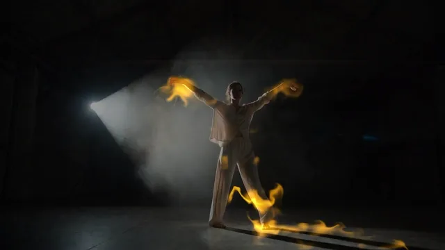
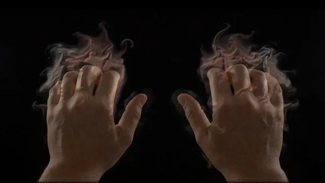
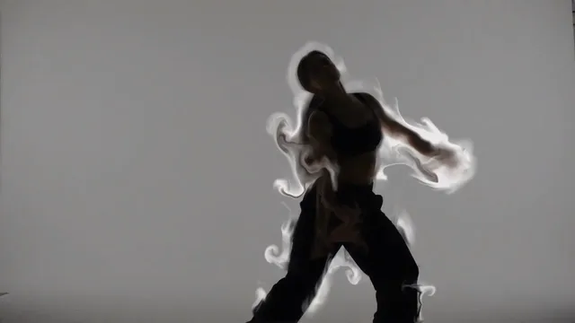
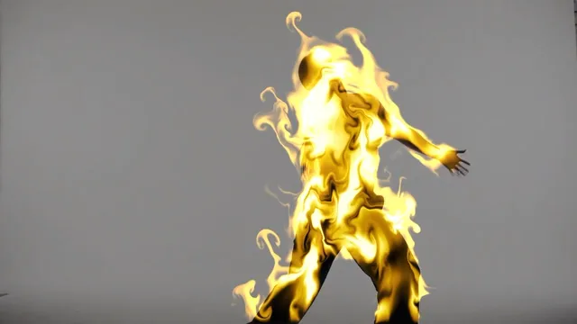

# Fluid

**New to fluid simulation?** A fluid simulation works out, many times a second, how air or water
moves: each little patch pushes its neighbors, carries what floats in it along, curls into eddies,
and can't be squeezed into less room. Smoke, ink in water and flames are all something carried by a
moving fluid. In a video-driven fluid the picture does the stirring: whatever moves in it drags the
fluid along, and it pours in the smoke, ink or heat the fluid carries. It is the look of a hand
leaving a trail of smoke, or a dancer on fire, in music videos and live visuals.

This effect runs a real fluid simulation over your picture, on the GPU, in three looks. **Fire**
(the default): flames pour off whatever moves and rise, flicker and lick around it. **Smoke**: soft,
see-through smoke that curls off and rises. **Ink**: the picture's own colors swirl and marble like
ink dropped in water. It finds what to pour from by movement, brightness, or a depth map or mask on
input 3 (with a mask, a whole silhouette burns), and the picture's movement, measured by its own
optical flow, is the force that stirs the fluid. The music makes it leap: on the beats the flames
jump and flare. The cross-platform options so far were mouse-driven (touchFluid, last updated in
2022), a project file built on the Palette's optical flow, or NVIDIA Flow, which runs only on
Windows with an NVIDIA card; this one is a single MIT `.tox` that runs on a Mac and on the free
license.

**[Download fluid.tox](https://github.com/kevinraymond/touchdesigner-effects/releases/latest/download/fluid.tox)**
· saved in TouchDesigner 2025.33230 (older builds may not open it) · works on the free
Non-Commercial license

## Use it

1. Drag `fluid.tox` into your network. It shows TouchDesigner's sample movie (grass swaying in front
   of a building) with a soft white ball circling over it, trailing flames, straight away.
2. Wire your picture into input 1: a webcam (Video Device In), a video, anything. The result is on
   output 1, at the input's size. Whatever moves pours flames.
3. Optional: wire audio or beat channels into input 2 (see Audio input).
4. Optional: wire a depth map or a mask lined up with input 1 into input 3, and set Emit From to Depth
   or Mask (see Emit From).
5. Pick a Look: Fire, Smoke or Ink (below). Reset clears the fluid.

Open Window (on the effect's page) shows it full size; Esc closes the window.

To update, delete your copy and drag in the new `fluid.tox`. Dragging a `.tox` in embeds a copy,
so a new release doesn't reach it on its own. You can also point the COMP's External .tox at a
downloaded file.

## Looks

**Fire** (the default, the picture at the top): heat pours in unevenly, flickering, and rises fast;
its color goes from orange through yellow to white as it gets hotter, added onto the picture, and it
cools within about half a second, so flames lick rather than stream.

**Smoke**: soft and see-through, thicker where more has poured in, lit from above left so its
billows show, rising and thinning out over a couple of seconds. It takes the picture's colors where
it pours in, lifted so dark clothes still show, or one color.

**Ink**: the picture's own colors, sharp and opaque, swirling and lingering like ink in water; it
doesn't rise. It shows best on a light background.

Linger sets how long each lasts (half gone after about 4 s for Ink, 1.2 s for Smoke and 0.4 s for
Fire at 0.5), and Rise adds to each look's own rise (Ink none, Smoke some, Fire a lot).

## Emit From

Where the picture pours ink, smoke or heat into the fluid:

- **Movement** (the default): what moves. Someone who holds still stops pouring; moving shadows
  count too, and the camera must stay still, or everything pours.
- **Brightness**: what is bright, moving or not: a lit performer on a dark stage, a beam of light.
- **Depth (Input 3)**: what stands in front of what lies to its left and right in the depth map, as
  in [Particles](particles.md): floors and walls drop out, while someone cut off by the left or right
  edge of the frame drops out too and feet merge with the floor. Depth Type reads depth estimators
  (Depth Anything; brighter nearer), the RealSense and Kinect TOPs (Distance 0-1) and the Kinect Azure
  TOP (Distance in Meters, with Max Distance). With nothing on input 3, the picture's brightness
  stands in, and only what is brighter than half counts.
- **Mask (Input 3)**: what is inside the mask, white inside (MediaPipe, the NVIDIA Background TOP).

Sensitivity lowers the bar in each: slower movement, dimmer brightness, farther depth or a grayer
mask counts as well. With Fire and Depth or Mask, the whole subject burns, still or moving:

## Parameters

The Fluid page, top to bottom:

| Parameter | Default | What it does |
|---|---|---|
| Look | Fire | What the fluid carries: Ink, Smoke or Fire (see Looks). |
| Reset | | Clears the fluid: no ink, smoke or heat left, and still. |
| Emit From | Movement | Where the picture pours in: Movement, Brightness, Depth (Input 3) or Mask (Input 3) (see Emit From). |
| Sensitivity | 0.5 | How easily it pours: slower movement, dimmer brightness, farther depth or a grayer mask counts as well. |
| Depth Type | Brighter Is Nearer | What input 3 holds: Brighter Is Nearer (depth estimators, masks), Distance 0-1 (RealSense, Kinect: 0 near, 1 far, black where the camera got no reading, which is left out) or Distance in Meters (Kinect Azure). Grayed out unless Emit From is Depth or Mask. |
| Max Distance | 4 | For Distance in Meters: how far away, in meters, counts as the far end of the depth. |
| Amount | 0.5 | How much pours in where the picture emits. |
| Linger | 0.5 | How long it lasts before it fades: 0.5 is the look's own, 0 a quarter of that, 1 four times. |
| Push | 1 | How strongly the picture's movement drags the fluid along. |
| Swirl | 0.5 | How much the fluid curls into swirls and eddies. |
| Rise | 0 | Added to the look's own rise; below 0 it sinks. |
| Color | Picture | For Ink and Smoke: the picture's colors where they pour in, or Orange, Blue or White. Fire has its own. Grayed out for Fire. |
| Backdrop | 0.6 | How bright the picture behind the fluid is, 0 (black) to 1. |
| Loudness | 0.7 | How much input 2's loudness thickens and thins the pour: at 1, quiet passages pour a third of Amount and the loudest a fifth more; 0 for a steady pour. |
| Beat Puffs | 0.5 | On the beats the fluid puffs: it leaps up and churns, the pour flares, and the flames burn hotter (the smoke glows) for a moment. A flash: Calm allows one a second (every second or third beat at dance tempos), Up to 3 per second every beat up to 180 BPM, Off none. 0 turns it off. |
| Song Moments | On | With Fosfora's signal on input 2: builds and drops (see Audio input). |
| Flashing | Calm | Off never flashes. Calm allows at most one flash a second. Up to 3 per second is the WCAG 2.3.1 limit. |
| Open Window | | Shows the picture in its own window, 1280 x 720 or filling a display. |
| Full Screen | Off | Opens the window filling the whole display, for a projector or a second screen. |
| Display | 0 | Which display the window opens on; 0 is the primary display. |

The About page has Version, Built With (the TouchDesigner build it was saved in) and Open Docs.

## Audio input

**[Fosfora](https://github.com/kevinraymond/fosfora)** gives the most. Run `fosfora --signal`, drag
`fosfora_signal.tox` (in Fosfora's `integrations/touchdesigner/`) into your project, and wire it
into input 2. Its loudness thickens and thins the pour (Loudness). As often as Flashing allows, a beat
puffs (Beat Puffs): the fluid leaps up where it is thick and churns into more swirls, the pour flares,
and the flames burn hotter (the smoke catches more light) for a moment. With Song Moments on:

- **Builds:** the fluid curls into more and more swirls as a build rises, up to three times Swirl,
  and calms over the two seconds after it.
- **Drops:** a puff three times as strong, lasting a second, also as often as Flashing allows.
  Fosfora's drop detection is experimental.

Its level comes from Fosfora's `bass`, which swells with each beat and between passages; Fosfora's
`energy` is loudness over three seconds, nearly constant on mastered music.

**Any input:** loudness and beats do the same. Raw audio (an Audio File In or Audio Device In CHOP)
gives beats from a kick detector and a beat clock (below, Experimental); its loudness is measured
against its own recent peak, so the pour follows the music's swells rather than its overall volume.
TouchDesigner's audioAnalysis gives beats from its kick or onset channels and loudness from its
energy.

**Nothing wired:** a steady pour at Amount, no puffs.

Measured on a song as raw audio (`dev/reaction.py`), the picture changes 1.12 times as much in the
half second after a beat as before it, against 0.93 with no audio at the same moments, with Flashing
on Calm, which lets about one beat in three puff at that tempo. Leap and churn alone measured 0.98: a
fluid takes a moment to move, so what it does on a beat spreads into the next; the flare and glow
are what land on the beat.

## Performance

60 fps at 1280 x 720 on the reference machine (MacBook Pro, Apple M2 Pro, 16 GB, macOS 15.6,
TouchDesigner 2025.33230), with default parameters and a beat far busier than music on input 2. Each
frame took 2.6 ms on the GPU (95th percentile 3.4 ms) and 0.6 ms on the CPU (95th percentile
0.6 ms), the median of three runs. GPU times on this machine vary by about a third from run to run:
the same network measured 3.5 to 4.3 ms earlier the same night.

The pressure solve is the biggest single step (0.8 to 1.0 ms: 40 Jacobi iterations at a quarter of
the picture's size), then the optical flow at 1/4 and 1/8 (about 0.9 ms together) and the dye at the
picture's size (0.3 ms). Smoke costs a little less, Ink about the same; Depth adds about 0.3 ms for
its row search, which cooks only while Emit From is Depth or Mask. A larger picture costs more in
the flow and the dye. Nothing inside cooks while the output is unused, whether inputs 2 and 3 are
wired or not.

## Accessibility

- **Flashing.** A beat's puff throws bright flames (or thick smoke) up at once and makes them flare
  and glow, so it counts as a flash, and so does a drop's. Both pass through one gate that follows the
  Flashing parameter: Off never puffs, Calm (the default) allows at most one a second, and Up to 3 per
  second is the WCAG 2.3.1 limit, which no setting exceeds. Loudness only thickens and thins the
  pour, which changes the picture gradually, so it isn't gated.
- **No red flashes.** Flames are never pure red: their coolest color is orange, with green at least
  0.6 of red, so red stays under the 80% at which WCAG counts a color as saturated red (it measures in
  linear light, where a dark orange can still count). Flickering red flame edges measured 2.5 red
  flashes a second before this.
- **No meaning in color.** The fluid takes the picture's colors, one of orange, blue and white, or the
  flames' orange-to-white, as decoration; hotter flames are brighter as well as yellower.

The flash rates were measured, not assumed. The test recorded the output while it fed a beat far
busier than music: 8 beats, 2 bars and 1 drop a second. The table gives the flashes in the worst
second, by WCAG's area rule, at Off, Calm and Up to 3 per second:

| Clip | Fire (the default) | Smoke | Ink | The clip alone |
|---|---|---|---|---|
| Dancer in a hazy warehouse | 1.5, 2.0, 2.5 | 0.5, 1.0, 1.5 | 0.5, 2.0, 1.5 | 1.0 |
| Hands against black | 1.5, 2.0, 3.0 | | | 1.5 |
| People crossing a plaza | 0.5, 1.0, 1.0 | | | 0.5 |
| Dancer, a beat at 140 BPM | 1.0, 2.0, 2.5 | | | 1.0 |

Fire at Off stays within half a flash of the footage, the flames' own flicker; every beat puffing,
before the puffs went through the gate, measured 2.0 at Off on the dancer. Up to 3 per second on the
hands reaches WCAG's limit of 3 and no more. Smoke and Ink soften the footage's own flicker. No red
flashes.

## Experimental

- Drop puffs depend on Fosfora's drop detection, which is experimental.
- Beats from raw audio come from a kick detector and a beat clock that locks to the kicks' tempo. It
  takes a few beats to lock and can still add or miss beats where the kicks don't keep the beat;
  Fosfora or audioAnalysis give steadier beats.
- Cuts in the input are found by a heuristic (shared with Datamosh: a change several times the usual
  one between frames); across a cut the motion is ignored for that frame, and a cut it misses gives
  one frame of meaningless push.

## Credits and license

MIT. The shaders and operators are written for this library: the motion held between the input's
frames and its drag on the fluid, the looks, and the beat's leap, churn and glow among them. The
optical flow and the resampling (`lib/glsl`) are shared with [Datamosh](datamosh.md), the depth
reading with [Particles](particles.md) and [Point Cloud](point_cloud.md).

- **Stable fluids:** J. Stam, "Stable Fluids" (SIGGRAPH 1999): semi-Lagrangian advection and the
  pressure projection; on the GPU as M. Harris laid it out in "Fast Fluid Dynamics Simulation on the
  GPU" (GPU Gems, chapter 38, 2004): Jacobi iteration of the pressure, one pass per step.
- **Vorticity confinement and buoyancy:** R. Fedkiw, J. Stam and H. W. Jensen, "Visual Simulation of
  Smoke" (SIGGRAPH 2001).
- **Smoke that absorbs light as it thickens:** the Beer-Lambert law.
- **The motion:** Lucas-Kanade optical flow, written from B. D. Lucas and T. Kanade, "An Iterative
  Image Registration Technique with an Application to Stereo Vision" (1981).
- **Ink kept sharp:** a Catmull-Rom bicubic (Catmull and Rom, 1974), clamped to its neighbors. The same
  shared helpers (`lib/glsl/common.glsl`) carry Chris Wellons' lowbias32 integer hash
  ([hash-prospector](https://github.com/skeeto/hash-prospector), public domain, the Unlicense),
  which Fluid doesn't use.
- **Fire's flicker:** TouchDesigner's built-in simplex noise.
- **Depth Type:** the RealSense, Kinect and Kinect Azure TOPs' depth, as their help pages describe
  it.
- **Read during the survey, not used:** [touchFluid](https://github.com/kamindustries/touchFluid)
  (kamindustries, MIT), the community
  [Fluid Simulation in TOPs](https://derivative.ca/community-post/asset/fluid-simulation-tops/71458)
  (no license stated), [NVIDIA Flow](https://docs.derivative.ca/NVIDIA_Flow_TOP) (Windows and NVIDIA
  only). None of their code was used.
- With nothing wired in, it shows TouchDesigner's own sample media; none ships in the `.tox`.
- **Beats from raw audio** (the library's audio input, `lib/audio_callbacks.py`): a kick is a jump
  in the low band's loudness, and the beat clock takes its tempo from the gaps between kicks, each
  gap voting for the beat lengths it is a whole multiple of: inter-onset-interval tempo induction,
  the idea behind S. Dixon's "Automatic Extraction of Tempo and Beat from Expressive Performances"
  (Journal of New Music Research, 2001). Followed, not copied: written for this library.
- **Flash limits:** [WCAG 2.3.1](https://www.w3.org/WAI/WCAG22/Understanding/three-flashes-or-below-threshold.html), measured with this library's tools (`dev/flash.py`, `dev/flashcount.py`).

Preview footage: Kevin Raymond, touchdesigner-effects,
[CC BY 4.0](https://creativecommons.org/licenses/by/4.0/). It is AI-generated (see the
[repository README](../../README.md#demo-footage)) and shows no real person. The silhouette's mask
(input 3 in the last preview) is its depth map, estimated with
[Depth Anything 3](https://github.com/ByteDance-Seed/Depth-Anything-3)'s Mono-Large model (Apache
2.0), one frame at a time, and held steady from frame to frame by fitting each frame's scale to the
one before (written for this library).
