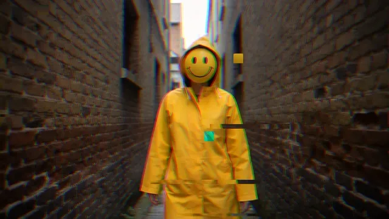

# Glitch

**New to glitch art?** It imitates broken digital video: blocks of the picture jump to the wrong
place or freeze, rows slip sideways as if the signal lost sync, and the red, green and blue parts of
the picture drift apart. It is the look of a corrupted video file or a failing stream, used on
purpose in music videos and VJ sets.

This effect breaks the picture on the music. Every beat tears a few thin slivers of rows sideways,
glitches a few single blocks and kicks the RGB split, too small an area to count as a flash. On the
one of each bar a big burst comes: for a moment blocks shift, freeze, smear or lose their colors and
whole bands of rows tear; then the picture is whole again. A burst's damage holds still while it
lasts instead of flickering, and every burst counts as a flash, so the Flashing setting decides how
often they may come: once a second at most by default, or never. Free glitch components for
TouchDesigner exist, but none states a license and few follow the music; this one is MIT, documented
and built around the beat.

**[Download glitch.tox](https://github.com/kevinraymond/touchdesigner-effects/releases/latest/download/glitch.tox)**
· saved in TouchDesigner 2025.33230 (older builds may not open it) · works on the free
Non-Commercial license

## Use it

1. Drag `glitch.tox` into your network. It shows TouchDesigner's sample movie (grass in the wind)
   tearing and breaking up every 1.6 s straight away.
2. Wire any TOP into input 1. The result is on output 1, at the input's size.
3. Optional: wire audio or beat channels into input 2 (see Audio input): the glitches then follow
   its beats and the bursts its bars.

Open Window (on the effect's page) shows it full size; Esc closes the window.

To update, delete your copy and drag in the new `glitch.tox`. Dragging a `.tox` in embeds a copy,
so a new release doesn't reach it on its own. You can also point the COMP's External .tox at a
downloaded file.

## Parameters

The Glitch page, top to bottom:

| Parameter | Default | What it does |
|---|---|---|
| Bursts | On Bars | When a big burst comes. On Bars (on the one of each bar) and On Beats follow input 2 (with nothing wired, every 1.6 s). Steady: every 1.6 s. Off: no bursts and no beat glitches, only the RGB split. Flashing limits how often bursts may come; the small glitches on every beat don't count as flashes. |
| Amount | 0.5 | How much of the picture a burst breaks, 0-1. |
| Length | 0.15 | How long a burst lasts, in seconds (0.05 to 0.5). |
| Block Size | 32 | Size of the blocks a burst breaks, in pixels at 720 high; it scales with the picture. |
| Blocks | On | In a burst, blocks shift to another part of the picture, freeze on the frame from before the burst, smear their left column across, or swap and crush their colors. |
| Tears | On | In a burst, bands of rows slip sideways, as if the signal lost sync. |
| RGB Split | 0.2 | How far red and blue drift apart, always: it kicks out on every beat and settles, goes three times as far in a burst, and widens with loudness on input 2. |
| Song Moments | On | With Fosfora's signal on input 2: a build breaks more of the picture as it rises, and a drop breaks all of it once. |
| Flashing | Calm | How often a burst may come. Off: never, and no beat glitches either (only the RGB split). Calm: at most once a second. Up to 3 per second: the WCAG 2.3.1 limit, which no setting exceeds. |
| Open Window | | Shows the picture in its own window, 1280 x 720 or filling a display. Esc closes it. |
| Full Screen | Off | Opens the window filling the whole display, for a projector or a second screen. |
| Display | 0 | Which display the window opens on; 0 is the primary display. |

The About page has Version, Built With (the TouchDesigner build it was saved in) and Open Docs.

## Audio input

**[Fosfora](https://github.com/kevinraymond/fosfora)** gives the most. Run `fosfora --signal`, drag
`fosfora_signal.tox` (in Fosfora's `integrations/touchdesigner/`) into your project, and wire it
into input 2. Every beat brings the small glitches, bursts follow its bars (or beats, Bursts), and
with Song Moments on:

- **Builds:** as a build rises, each burst breaks more of the picture, up to two and a half times
  Amount.
- **Drops:** a drop breaks the whole picture once, through the same Flashing gate as every burst.
  Fosfora's drop detection is experimental.

Its level comes from Fosfora's `bass`, which swells with each beat and between passages; Fosfora's
`energy` is loudness over three seconds, nearly constant on mastered music.

**Any input:** small glitches on every beat, bursts on its bars (On Bars) or beats (On Beats), and
loudness widens the RGB split.
Raw audio (an Audio File In or Audio Device In CHOP) gives beats from a kick detector and a beat
clock: Once the kicks keep to a tempo, a beat clock locks to them: beats then come on the beat even
when a kick is missed, a kick between beats is left out, and a bar is every 4 beats (which beat
starts the bar is a guess). It stops 8 beats after the kicks do, so a breakdown goes quiet, and
while it isn't locked every kick is a beat. TouchDesigner's audioAnalysis gives beats from its kick
or onset channels.

**Nothing wired:** the small glitches and the bursts come every 1.6 s instead, so the effect shows
itself.

## Performance

60 fps at 1280 x 720 on the reference machine (MacBook Pro, Apple M2 Pro, 16 GB, macOS 15.6,
TouchDesigner 2025.33230), with default parameters. Each frame took 0.24 ms on the GPU (95th
percentile 0.41 ms) and 0.28 ms on the CPU (95th percentile 0.36 ms): one pass for the damage and
the split, one to hold the picture for frozen blocks. Larger pictures cost more in proportion.
Nothing inside cooks while the output is unused.

## Accessibility

- **Flashing.** Every burst is a flash: the picture changes at once and changes back. Bursts pass
  one gate that follows the Flashing parameter: Off never bursts, Calm (the default) allows at
  most one a second, and Up to 3 per second is the WCAG 2.3.1 limit, which no setting exceeds.
  After the gate, a budget keeps this effect to about 2 bursts a second even at Up to 3, leaving
  room for what the footage does by itself.
- **Beat glitches stay small.** The slivers and blocks on every beat are scattered and few (five of
  each), well under the area WCAG counts as a flash (a quarter of a 10-degree field), so they can
  follow every beat; Off turns them off too.
- **No flicker of its own.** A burst's damage comes from one seed and holds still while it lasts,
  rather than changing every frame; between bursts, the RGB split is steady.
- **No meaning in color.** The RGB split and crushed colors are decoration; nothing is signaled by
  hue.

The flash rates were measured, not assumed. The test recorded the output while it fed a beat far
busier than music: 8 beats, 2 bars and 1 drop a second. The table gives the flashes in the worst
second, by WCAG's area rule:

| Clip | Off | Calm | Up to 3 per second | The clip alone |
|---|---|---|---|---|
| Dancer in a hazy warehouse | 1.0 | 1.5 | 2.0 | 1.0 |
| People crossing a plaza | 0.5 | 1.0 | 1.5 | 0.5 |
| Dancer in a hazy warehouse, no beat (steady glitches) | 1.0 | 1.0 | 1.0 | 1.0 |

A burst breaks many small blocks and bands rather than the whole picture, so most bursts stay under
the area WCAG counts, and the glitches on every beat (eight a second in this test) didn't register
at all: Calm adds at most half a flash a second here, and Up to 3 per second stays at 2 or under.
Red flashes, which WCAG counts separately, came to half a flash a second at Calm and one at Up to 3
per second (the colored fringes of the split's kick), well under its limit of 3; none at Off or
with no beat.

## Experimental

- Drop moments depend on Fosfora's drop detection, which is experimental.
- Beats from raw audio come from a kick detector and a beat clock that locks to the kicks' tempo. It
  takes a few beats to lock and can still add or miss beats where the kicks don't keep the beat, and
  which beat starts a bar is a guess; Fosfora or audioAnalysis give steadier beats.

## Credits and license

MIT. The shader and operators are written for this library: the bursts and the flash budget
among them.

- **The damage** (slivers torn sideways, blocks that jump, freeze or lose their color, rows that
  slip) is the common vocabulary of digital glitch art, after broken video streams and files.
- **Dice:** Chris Wellons' lowbias32 integer hash ([hash-prospector](https://github.com/skeeto/hash-prospector), public domain), which picks each burst's
  blocks and tears.
- **Read during the survey, not used:** td-glitch-effects, Glitch Machine (paid).
- **Beats from raw audio** (the library's audio input, `lib/audio_callbacks.py`): a kick is a jump
  in the low band's loudness, and the beat clock takes its tempo from the gaps between kicks, each
  gap voting for the beat lengths it is a whole multiple of: inter-onset-interval tempo induction,
  the idea behind S. Dixon's "Automatic Extraction of Tempo and Beat from Expressive Performances"
  (Journal of New Music Research, 2001). Followed, not copied: written for this library.
- **Flash limits:** [WCAG 2.3.1](https://www.w3.org/WAI/WCAG22/Understanding/three-flashes-or-below-threshold.html), measured with this library's tools (`dev/flash.py`, `dev/flashcount.py`).

Preview footage: Kevin Raymond, touchdesigner-effects,
[CC BY 4.0](https://creativecommons.org/licenses/by/4.0/). It is AI-generated (see the
[repository README](../../README.md#demo-footage)) and shows no real person.
