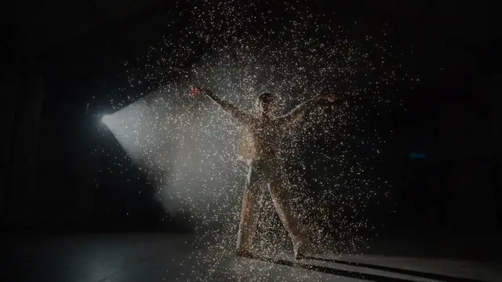
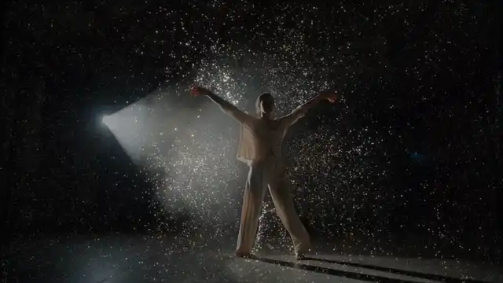
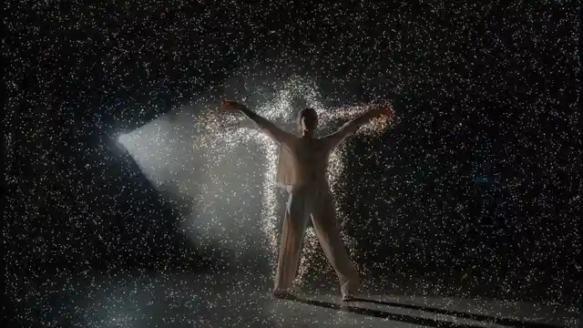

# Particles

**New to interactive particles?** Particles are thousands of tiny dots, each moving on its own:
born somewhere, carried by a wind, swirled around, fading away. Interactive particles come off
something in the picture, usually a person, so the dancer seems to shed light or smoke. The hard part
is knowing where the person is. A depth map does it best: a picture of how far away things are,
brighter nearer, from a depth camera (Kinect, RealSense) or a depth estimator (Depth Anything)
running on any video. Without one, the movement in the picture is the next best clue.

This effect sends particles off its subject, each in the picture's color where it was born. The air
carries them up and swirls them around, and they fade over a few seconds. Two more behaviors fill
the whole frame with particles instead: in Push the subject shoves through them and they light up
where it touches them, and in Flow they stream past and part round it (see Behaviors). The music
moves the whole cloud: loudness thickens and thins the stream, every beat fires a burst (of big
sparks, as often as Flashing allows) and kicks the cloud outward, and every bar swings the wind to a new direction; with Fosfora's signal, a build
stirs up the air and a drop sends a shockwave out. It finds its subject with whatever you give it:
depth or a mask on input 3 for the best result, and with only a picture, a webcam say, what moves
(or what differs from the empty room). Find on Auto chooses for itself, and the Subject view says
which way it took. The free route so far was wiring the Palette's particlesGpu by hand from a Kinect
tutorial; this takes any depth or mask TOP, or none, and is one MIT `.tox`, up to 65,536 particles
on the GPU.

**[Download particles.tox](https://github.com/kevinraymond/touchdesigner-effects/releases/latest/download/particles.tox)**
· saved in TouchDesigner 2025.33230 (older builds may not open it) · works on the free
Non-Commercial license

## Use it

1. Drag `particles.tox` into your network. It shows TouchDesigner's sample movie (a white birch
   among dark leaves) with particles peeling off the trunk straight away.
2. Wire your picture into input 1: a webcam (Video Device In), a video, anything. The result is on
   output 1, at the input's size. With only a picture, particles come off whatever moves.
3. For the best result, wire a depth map or a mask lined up with input 1 into input 3 (see What you
   have, what you get). Find on Auto switches to it by itself.
4. Optional: wire audio or beat channels into input 2 (see Audio input).
5. Set Show to Subject to see what the particles come from, in orange, with a label saying how it
   was found; tune Find and the settings under it there, then set Show back to Particles.
6. Pick a Behavior: Emit (particles peel off the subject), Push or Flow (below).

Open Window (on the effect's page) shows it full size; Esc closes the window.

To update, delete your copy and drag in the new `particles.tox`. Dragging a `.tox` in embeds a copy,
so a new release doesn't reach it on its own. You can also point the COMP's External .tox at a
downloaded file.

## Behaviors

**Emit** (the default, the picture at the top): particles are born on the subject, or only along its
outline (Emit From), and leave it outward, then drift on the air (Drift, Direction) and fade.

**Push**: particles fill the frame, hanging in still air and glowing dimly. The subject is solid: as
it moves it shoves them aside, and the ones it shoves light up and swell, settling again as they
slow down. Its path stays clear until new particles fill it in, over about Life seconds. Nothing is
born on the subject, so it shows as a clean cutout.

**Flow**: particles stream across the frame on the wind, along Direction at Drift's speed, and part
round the subject, speeding along its sides and closing in again behind it. Where the subject moves
into the stream, the particles pass behind it instead of being pushed, so it never leaves a hole; the
ones born behind it take its colors and carry them off when it moves on.

In Push and Flow, three times Rate particles are born each second, all over the frame, so about 3 x
Rate x Life fill it (37,500 at the defaults); one that leaves an edge comes back at the opposite one.
A beat's burst still leaves the subject's outline, and a beat pulses the whole field out from the
subject's middle and back, rather than kicking it outward as Emit does: with particles that come
back round, a kick would gather them at the edges of the frame. The air parts round each person in
the frame. Arms and other thin parts let a little air through, out of sight behind them, so the
stream bends gently round them instead of turning sharply.

## What you have, what you get

Depth gives the best result: the whole subject, still or moving, in any light. Without it the effect
still works, as well as a picture alone allows. Find on Auto picks the first row that applies; the
other ways are a menu choice away.

| What you have | Find | What emits |
|---|---|---|
| A depth camera or estimator on input 3 (Kinect, RealSense, Depth Anything), with Depth Type set to match | Auto: Stand Out | Whatever stands in front of what is beside it: people, still or moving. The best result. |
| A depth camera close up, at a desk say, where you touch the edges of the frame | Nearer Than Far Limit, Far Limit just behind you | Everything nearer than Far Limit: you, and anything as near as you (the desk's edge, a monitor). |
| A mask on input 3 (MediaPipe, the NVIDIA Background TOP) | Auto: Stand Out | Inside the mask. Nearer Than Far Limit keeps people who touch the edge of the frame. |
| Only a picture, from a camera that stays still: a webcam, a video | Auto: Movement | Whatever moves: hands, faces, edges and patterns as they move; a plain shirt barely counts, since a flat color looks the same when it shifts. Someone who holds still fades out within a couple of seconds; moving shadows count too. If the camera itself moves, everything moves: then only depth helps. |
| Only a picture, from a fixed camera, with a moment when the frame is empty | Background, then press Capture Background | Everything that isn't the empty room, still or moving, as long as the camera and the light stay put. A video where someone is always in the frame has no empty room to keep: use Movement. |
| A lit performer on a dark stage, no depth | Stand Out (it reads the picture's brightness as depth) | Bright things that stand out from what is beside them. |
| Nothing wired (TouchDesigner's sample movie) | Auto: the sample's brightness as depth | The birch trunk: a first look, nothing more. |

The Subject view's label names the row in use, such as `AUTO: DEPTH ON INPUT 3 - STAND OUT` or
`AUTO: NO DEPTH ON INPUT 3 - MOVEMENT`. Auto decides by what input 3 carries, not by whether
something is wired: a depth input that goes black (a camera unplugged, a file that didn't load)
falls back to Movement on its own.

### Depth and masks

Set Depth Type to what input 3 holds:

| Input 3 | Depth Type |
|---|---|
| A depth estimator (Depth Anything and the like), a mask | Brighter Is Nearer |
| The RealSense TOP (Windows only: TouchDesigner has none on Apple Silicon), the Kinect TOP | Distance 0-1 |
| The Kinect Azure TOP | Distance in Meters, with Max Distance at the far end of your space |

- **Depth cameras give distance, not nearness:** 0 is at the camera, and black also means the
  camera got no reading there (the shadow beside anything near it, a dark screen, a window). The two
  Distance types flip it and leave the black out, so holes never turn into the nearest thing in the
  room. Don't invert a camera's depth yourself before wiring it in: the holes would become far away
  instead, and everything beside them would stand out.
- **Depth estimators:** pick a video model or one that normalizes the whole clip at once: a model
  that stretches every frame to its own range makes the depth pump as people move, and the particles
  jump with it.
- **A mask** (white inside, black outside, from any segmentation tool): Stand Out works, and Nearer
  Than Far Limit keeps people who touch the edge of the frame.
- **Depth from a plain webcam:** estimate it live and wire it into input 3. Each of these needs its
  own install (a Python environment, a model download or a plugin), which is why none can come
  inside this `.tox`:
  - Derivative's [TDDepthAnything](https://github.com/TouchDesigner/TDDepthAnything) runs Depth
    Anything inside TouchDesigner (PyTorch, through TDPyEnvManager);
    [olegchomp's version](https://github.com/olegchomp/TDDepthAnything) runs it with TensorRT on
    Windows and NVIDIA, and [appletd](https://github.com/ojrgb/appletd) runs Apple's Vision models on
    macOS. Check each one's model license if your work is commercial.
  - [MediaPipe for TouchDesigner](https://github.com/torinmb/mediapipe-touchdesigner) (MIT, Mac and
    Windows) gives a person mask; on Windows with an NVIDIA RTX card, so does TouchDesigner's own
    NVIDIA Background TOP.
- **Two movie files** (a recording and its depth): make the depth show the recording's frame, or the
  two drift apart whenever the recording plays without the effect (when it also feeds something
  else). Set the depth's Movie File In to Play Mode Specify Index, Index Unit Indices, and its Index
  to an Info CHOP on the recording's Movie File In: `op('info1')['index']`.

### How each way finds the subject

- **Stand Out** counts what is nearer than Far Limit and nearer, by at least Stand Out, than
  something to its left and something to its right in the same row. A floor is about as near all
  along a row, and a wall gets steadily nearer or farther along one, so neither passes; a person has
  background on both sides. It needs no picture of the empty room, so it works with a moving camera.
  Far Limit then drops whatever stands out but is far away, such as beams overhead. Two things it
  can't tell: someone cut off by the left or right edge of the frame has nothing beside them on that
  side and drops out, and feet merge with the floor they stand on. Something nearer than the wall
  behind it, a monitor say, counts too: Far Limit cuts it if it is farther than the people. Lone
  specks of a depth camera's noise are left out.
- **Nearer Than Far Limit** counts everything nearer than Far Limit: for a mask, or a depth camera
  mounted so that it doesn't see the floor.
- **Movement** keeps a picture of the background that follows the scene a couple of seconds behind,
  and counts what differs from it by more than Sensitivity allows. Where something has just left,
  the background catches up within about a second, so no ghost trails behind. A gesture keeps
  emitting for half a second after it stops. It sees change, so edges and patterns count more than
  flat colors. The camera has to stay still: when it moves (a phone in the hand, a pan), the whole
  picture counts as moving.
- **Background** compares each pixel's color with the empty room: input 1's picture when Capture
  Background was last pressed (the effect never opens a camera itself). Until then it works as Movement, and the label says so. Webcams change their
  exposure and color balance by themselves, most of all when someone steps in and fills the frame;
  the effect compares hue, which exposure leaves alone, and brightness after dividing out the drift,
  measured on the bulk of the picture (the room). Press Capture
  Background again after the camera moves or the light changes.

## Parameters

The Particles page, top to bottom:

| Parameter | Default | What it does |
|---|---|---|
| Show | Particles | Particles: the effect. Subject: what the particles come from, in orange, the depth beside it in blue when depth is in use, over the dimmed picture, with a label saying how it was found. |
| Find | Auto | What the particles come from: Auto, Stand Out, Nearer Than Far Limit, Movement or Background (see What you have, what you get). |
| Capture Background | | For Background: with the subject out of the frame, keeps input 1's picture as the empty room. Grayed out unless Find is Background. |
| Sensitivity | 0.5 | For Movement and Background (and Auto with no depth): how small a change counts. Raise it to catch slight movement; lower it if a still picture or camera noise emits. |
| Stand Out | 0.08 | How much nearer than what lies to its left and right something must be to count, as a share of the depth range (0 to 0.3). Grayed out unless Find is Auto or Stand Out. |
| Far Limit | 0.5 | Anything farther than this never counts, from 0 (farthest) to 1 (nearest). Raise it to drop the background; lower it if parts of the subject go missing. |
| Depth Type | Brighter Is Nearer | What input 3 holds: Brighter Is Nearer (depth estimators, masks), Distance 0-1 (the RealSense and Kinect TOPs; black, no reading, is left out) or Distance in Meters (the Kinect Azure TOP). |
| Max Distance | 4 | For Distance in Meters: the far end of the depth, in meters (Far Limit and Stand Out are fractions of it). |
| Behavior | Emit | What the particles do: Emit, Push or Flow (see Behaviors). |
| Emit From | Body | For Emit: where particles are born, anywhere on the subject or only along its outline. |
| Rate | 5000 | Particles born per second, 0 to 30,000: on the subject in Emit; three times as many, all over the frame, in Push and Flow. At most 65,536 are alive at once. |
| Life | 2.5 | How long a particle lives, in seconds. Each lives between half and one and a half times this. |
| Size | 3 | Size of a particle in pixels at 720 high; it scales with the picture. |
| Speed | 0.15 | How fast particles leave the subject, in frame heights per second (in Push and Flow, those of a beat's burst). |
| Drift | 0.1 | For Emit and Flow: how fast the air blows, in frame heights per second, along Direction; below 0 it blows the other way. Push's air is still. |
| Direction | 0 | For Emit and Flow: which way the air blows, in degrees clockwise from straight up: 90 to the right, 180 down, -90 to the left. |
| Turbulence | 0.5 | How much the air swirls the particles around. |
| Color | Picture | The picture's color where each particle is born, lifted so dark clothes still glow, or orange, blue or white. |
| Glow | 0.5 | How much the particles glow around themselves. |
| Backdrop | 0.6 | How bright the picture behind the particles is, from 0 (black) to 1. |
| Loudness | 0.7 | How much the loudness of input 2 thickens and thins the stream. At 1, quiet passages emit a third of Rate and the loudest a fifth more; 0 keeps Rate steady. |
| Beat Bursts | 0.5 | On each beat of input 2, a burst of particles leaves the subject, up to three times as fast as the rest, and the whole cloud is kicked outward (Emit) or pulses out and back (Push, Flow). As often as Flashing allows, the burst is sparks: born two and a half times their size, shrinking back over about 0.3 s. 0 for none of it. |
| Bar Gusts | 0.5 | For Emit and Flow: on each bar of input 2 (every 4 beats when it has no bars), the wind swings to a new direction, up to about 35 degrees either side of Direction at 1, and eases there over 0.6 s; 0 keeps it blowing straight. |
| Song Moments | On | With Fosfora's signal on input 2: a build stirs the air up as it rises, and a drop sends a shockwave out from the subject. |
| Flashing | Calm | How often a burst may be sparks, which light up a patch of the picture at once. Off never; Calm at most once a second (about every other beat at dance tempos); Up to 3 per second is the WCAG 2.3.1 limit (every beat up to 180 BPM). The bursts, kicks, stream and wind come on every beat at any setting. |
| Open Window | | Shows the picture in its own window, 1280 x 720 or filling a display. Esc closes it. |
| Full Screen | Off | Opens the window filling the whole display, for a projector or a second screen. |
| Display | 0 | Which display the window opens on; 0 is the primary display. |

The About page has Version, Built With (the TouchDesigner build it was saved in) and Open Docs.

## Audio input

**[Fosfora](https://github.com/kevinraymond/fosfora)** gives the most. Run `fosfora --signal`, drag
`fosfora_signal.tox` (in Fosfora's `integrations/touchdesigner/`) into your project, and wire it
into input 2. Its loudness thickens and thins the stream (Loudness), every beat fires a burst and
kicks the cloud outward, the burst sparks as often as Flashing allows (Beat Bursts; in Push and Flow
the whole field pulses out and back), every bar swings the wind (Bar Gusts; in Flow the whole stream
turns, and Push has no wind to swing), and with Song Moments on:

- **Builds:** the air swirls harder as a build rises, up to three times Turbulence, and calms over
  the two seconds after it.
- **Drops:** a ring leaves the subject's middle and sweeps outward across the frame in 1.2 s,
  shoving the particles it passes. Fosfora's drop detection is experimental.

Its level comes from Fosfora's `bass`, which swells with each beat and between passages; Fosfora's
`energy` is loudness over three seconds, nearly constant on mastered music.

**Any input:** loudness, beats and bars do the same. Raw audio (an Audio File In or Audio Device In
CHOP) gives beats from a kick detector and a beat clock (below, Experimental) and a bar every 4
beats; its loudness is measured against its own recent peak, so the stream follows the music's
swells rather than its overall volume. TouchDesigner's audioAnalysis gives beats from its kick or
onset channels and loudness from its energy.

**Nothing wired:** a steady stream at Rate, the wind along Direction, no bursts.

## Performance

60 fps at 1280 x 720 on the reference machine (MacBook Pro, Apple M2 Pro, 16 GB, macOS 15.6,
TouchDesigner 2025.33230), with default parameters and a beat far busier than music on input 2.
With a depth clip on input 3, each frame took 2.6 ms on the GPU (95th percentile 3.1 ms) and 1.1 ms
on the CPU (95th percentile 1.4 ms), the median of three runs: 1.1 ms to draw the particles, 0.5 ms
to blur their glow, 0.6 ms to move them and about 0.4 ms to find the subject, on a 320 x 180 copy of the picture and the depth
whatever their size. Without depth it costs about the same: 2.4 ms on Movement (people crossing a
plaza, Find on Auto), 3.1 ms on Background. Push and Flow add about 0.6 ms for the air that goes
round the subject: 3.0 ms (Push) and 3.1 ms (Flow) with the dancer's depth, 3.1 and 3.2 ms on the
plaza. Rate and Life barely change the cost: every one of the 65,536 particles is moved and drawn
every frame, alive or not, and at Rate 30000 with Life 4 a frame took 2.6 ms on the GPU. A larger
picture costs more to draw and blur. Nothing inside cooks while the output is unused, Background's
passes run only while Find is Background, and the air only in Push and Flow.

## Accessibility

- **Flashing.** A beat's burst of sparks lights up a patch of the picture at once, so sparks count
  as flashes. They pass through one gate that follows the Flashing parameter: Off never sparks, Calm
  (the default) allows at most one sparking burst a second, and Up to 3 per second is the WCAG 2.3.1
  limit, which no setting exceeds. The rest moves particles and adds them rather than lighting the
  picture, so it comes on every beat: particles fade in over a tenth of a second (Emit) or nearly
  half a second (Push, Flow) and out over the second half of their lives, and in Push the particles
  the subject shoves light up a few at a time, where it moves.
- **No meaning in color.** Particles take the picture's colors or one color, as decoration. The
  Subject view marks the subject in bright orange and the depth beside it in dim blue, so brightness
  tells them apart as well as hue, and its label says in words how the subject was found.

The flash rates were measured, not assumed. The test recorded the output while it fed a beat far
busier than music: 8 beats, 2 bars and 1 drop a second, so a burst and a kick (or pulse) 8 times a
second and a shockwave every second. The table gives the flashes in the worst second, by WCAG's area
rule, at Off, Calm and Up to 3 per second:

| Clip | Emit | Push | Flow | The clip alone |
|---|---|---|---|---|
| Dancer in a hazy warehouse, with her depth | 1.0, 1.0, 2.0 | 1.0, 1.0, 1.0 | 1.5, 1.0, 1.0 | 1.0 |
| Hands against black, with their depth | 1.0, 1.0, 1.0 | 1.0, 1.5, 1.5 | 1.0, 1.0, 1.0 | 1.5 |
| People crossing a plaza, no depth (Movement) | 0.0, 0.5, 1.0 | 1.0, 1.5, 1.5 | 0.5, 1.0, 1.0 | 0.5 |
| Dancer, a beat at 140 BPM (Emit) | 0.5, 1.0, 1.5 | | | 1.0 |

The last row is a dance tempo, a bar every 4 beats, where each burst's sparks shrink back before
the next. Before the sparks went through the gate, Emit on the dancer measured 2.5 under the busy
beat. Push on the plaza adds half a flash a second to the footage's own even at Off, the people's
shoves lighting particles up, and a flash at Calm and Up to 3 per second; everything else stays
within a flash of the footage (the dimmed backdrop takes some of its own flicker away), all of it
under WCAG's limit of 3. No red flashes.

## Experimental

- Drop moments depend on Fosfora's drop detection, which is experimental.
- Beats from raw audio come from a kick detector and a beat clock that locks to the kicks' tempo. It
  takes a few beats to lock and can still add or miss beats where the kicks don't keep the beat, and
  which beat starts a bar is a guess; Fosfora or audioAnalysis give steadier beats.

## Credits and license

MIT. The shaders and operators are written for this library: Stand Out's row search, Background's
exposure drift, Flow's particles waiting behind the subject and the beat's pulse among them. The depth reading (`lib/glsl`) is shared with
[Point Cloud](point_cloud.md).

- **Swirl:** curl noise (Bridson, Hourihan and Nordenstam, "Curl-Noise for Procedural Fluid Flow",
  SIGGRAPH 2007) on TouchDesigner's built-in simplex noise.
- **Push and Flow's air going round the subject:** the same paper's boundaries: the stream function,
  whose curl is the air's velocity, ramped down near an obstacle to one value across it.
- **The air's velocity on a grid:** each component taken on the sides of a cell, as on a staggered
  grid (Harlow and Welch, "Numerical Calculation of Time-Dependent Viscous Incompressible Flow of
  Fluid with Free Surface", Physics of Fluids, 1965), so no air is lost or gained in a cell and the
  particles neither gather nor thin out; they move by the midpoint rule, a standard method.
- **Push's shove:** a particle inside the subject is put back on its edge and the move becomes its
  speed, as in position-based dynamics (Müller, Heidelberger, Hennix and Ratcliff, "Position Based
  Dynamics", VRIPHYS 2006).
- **Dice:** the PCG hash from Jarzynski and Olano, "Hash Functions for GPU Rendering" (JCGT, 2020).
- **Movement:** a background that follows the picture a couple of seconds behind (running-average
  background subtraction, a standard method). **Background:** a picture of the empty room.
- **Depth Type:** the RealSense, Kinect and Kinect Azure TOPs' depth, as their help pages describe
  it.
- **Font:** the 5 x 7 bitmap font for the Subject view's labels was drawn for this library.
- **Read during the survey, not used:** the Palette's particlesGpu (Derivative).
- **Beats from raw audio** (the library's audio input, `lib/audio_callbacks.py`): a kick is a jump
  in the low band's loudness, and the beat clock takes its tempo from the gaps between kicks, each
  gap voting for the beat lengths it is a whole multiple of: inter-onset-interval tempo induction,
  the idea behind S. Dixon's "Automatic Extraction of Tempo and Beat from Expressive Performances"
  (Journal of New Music Research, 2001). Followed, not copied: written for this library.
- **Flash limits:** [WCAG 2.3.1](https://www.w3.org/WAI/WCAG22/Understanding/three-flashes-or-below-threshold.html), measured with this library's tools (`dev/flash.py`, `dev/flashcount.py`).

Preview footage: Kevin Raymond, touchdesigner-effects,
[CC BY 4.0](https://creativecommons.org/licenses/by/4.0/). It is AI-generated (see the
[repository README](../../README.md#demo-footage)) and shows no real person. Its depth map was
estimated with [Depth Anything 3](https://github.com/ByteDance-Seed/Depth-Anything-3)'s Base model
(Apache 2.0).
