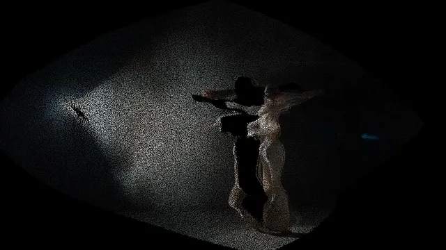

# Point Cloud

**New to point clouds?** A point cloud is a picture taken apart into dots, each put back at its
distance from the camera, so you can look at it from the side. The distances come from a depth map:
a picture of how far away things are, brighter nearer, from a depth camera (Kinect, RealSense) or a
depth estimator (Depth Anything) running on any video. Seen straight on, the cloud is the picture
again; as the camera moves round it, people stand out from the wall behind them and the floor runs
back into the room. It is the look of a 3D scan, of music videos shot with a depth camera and of the
"3D photo" a phone makes from a portrait.

This effect turns any picture and its depth into a cloud of up to 230,400 points, drawn three ways:
solid dots, soft dots that glow where they crowd, or a surface of blended splats that wraps the
picture over the depth. The camera sways round the cloud by itself, and the music moves it: loudness
swells the dots, each beat deepens the cloud, each bar swings the camera to a new angle; with
Fosfora's signal a build scatters the points and a drop blows the cloud apart. It cleans up the
depth as it goes: the steps of an 8-bit depth map are smoothed so walls don't show terraces, and
points on the edge between a person and the wall go to one side or the other instead of streaking
between them. The Palette's kinectPointcloud gives positions for you to draw; tutorials draw them
for one camera. This takes any depth TOP, or none, and is one MIT `.tox`.

**[Download point_cloud.tox](https://github.com/kevinraymond/touchdesigner-effects/releases/latest/download/point_cloud.tox)**
· saved in TouchDesigner 2025.33230 (older builds may not open it) · works on the free
Non-Commercial license

## Use it

1. Drag `point_cloud.tox` into your network. It shows TouchDesigner's sample movie (a white birch
   among dark leaves) as a cloud straight away, its bright trunk standing out in front.
2. Wire your picture into input 1: a video, a webcam (Video Device In), anything. The result is on
   output 1, at the input's size.
3. For real depth, wire a depth map lined up with input 1 into input 3 and set Depth Type to match
   (see Depth). With nothing on input 3, the picture's brightness stands in for depth: bright
   things come forward, which suits a lit performer on a dark stage and little else. It decides by
   what input 3 carries, not by the wire: a depth input that goes all black (a camera unplugged, a
   file that didn't load) falls back to the brightness too, with every point kept.
4. Optional: wire audio or beat channels into input 2 (see Audio input).
5. Pick a Look, then set the camera: Turn and Tilt for where it looks from, Distance for how near,
   Sway for how far it swings by itself (0 holds it still).

Open Window (on the effect's page) shows it full size; Esc closes the window.

To update, delete your copy and drag in the new `point_cloud.tox`. Dragging a `.tox` in embeds a
copy, so a new release doesn't reach it on its own. You can also point the COMP's External .tox at a
downloaded file.

## Depth

Set Depth Type to what input 3 holds:

| Input 3 | Depth Type |
|---|---|
| A depth estimator (Depth Anything and the like), a mask | Brighter Is Nearer |
| The RealSense TOP (Windows only: TouchDesigner has none on Apple Silicon), the Kinect TOP | Distance 0-1 |
| The Kinect Azure TOP | Distance in Meters, with Max Distance at the far end of your space |

- **How deep:** Depth sets how much farther the farthest points lie than the nearest. An estimator
  gives relative depth (no meters), so pick what looks right: at the default 1.5 the farthest lie
  two and a half times as far as the nearest. Estimators give disparity (one over distance), and the
  effect places points that way; a depth camera's distance is spread evenly.
- **Depth cameras give distance, not nearness:** 0 is at the camera, and black also means the
  camera got no reading there (the shadow beside anything near it, a dark screen, a window). The two
  Distance types flip it and leave the black out of the cloud. Don't invert a camera's depth
  yourself: the holes would turn into the nearest things in the room.
- **Depth estimators:** pick a video model or one that normalizes the whole clip at once; a model
  that stretches every frame to its own range makes the cloud pump in and out as people move. An
  estimator's edges are soft, so a person blends into the wall behind them over a few pixels: the
  effect puts each of those points on the side it is closer to.
- **Depth from a plain webcam:** estimate it live and wire it into input 3. Each of these needs its
  own install, which is why none can come inside this `.tox`: Derivative's
  [TDDepthAnything](https://github.com/TouchDesigner/TDDepthAnything) (PyTorch, through
  TDPyEnvManager), [olegchomp's version](https://github.com/olegchomp/TDDepthAnything) (TensorRT,
  Windows and NVIDIA), or [appletd](https://github.com/ojrgb/appletd) (Apple's Vision models on
  macOS). Check each one's model license if your work is commercial.
- **Two movie files** (a recording and its depth): make the depth show the recording's frame, or
  the two drift apart. Set the depth's Movie File In to Play Mode Specify Index, Index Unit Indices,
  and its Index to an Info CHOP on the recording's Movie File In: `op('info1')['index']`.

### Points From

- **Everything:** the whole picture.
- **The Subject (Stand Out):** only what is nearer than Far Limit and nearer, by at least Stand
  Out, than something to its left and something to its right in the same row: people, without the
  floor and the walls, floating on black. The same search as [Particles](particles.md)' Stand Out,
  with the same limits: someone cut off by the left or right edge of the frame drops out, and feet
  merge with the floor.
- **Nearer Than Far Limit:** everything nearer than Far Limit, for a mask or a depth camera that
  sees no floor.

## Looks

| Look | What it draws | Cost |
|---|---|---|
| Points | Solid round dots, the nearest in front. Each sits at a random spot within its cell of the grid, so the dots don't line up in rows (which makes moire from the side). | 3.9 ms |
| Glow | Soft dots added up: they glow where they crowd, at grazing angles and where the picture is bright. A dot that grows keeps its light, spread thinner. | 4.7 ms |
| Surface | Splats: soft discs lying in the surface, each spanning the step to the next points, blended into one skin and divided out, so the picture wraps over the depth with no gaps. | 6.5 ms |

Surface follows "High-Quality Surface Splatting on Today's GPUs" (Botsch, Hornung, Zwicker and
Kobbelt, 2005): a first pass draws only the splats' depth, a little farther back than they are; a
second adds up each splat's color times its weight, and its weight, wherever it passes that depth,
so splats on one surface blend and those on a surface behind are hidden; a third divides the colors
by the weights. Where the camera sees what the picture never showed, the wall behind a person say,
every look leaves a gap: there is nothing there to draw.

## Parameters

The Point Cloud page, top to bottom:

| Parameter | Default | What it does |
|---|---|---|
| Look | Points | Points, Glow or Surface (see Looks). |
| Points From | Everything | Everything, The Subject (Stand Out) or Nearer Than Far Limit (see Points From). |
| Stand Out | 0.08 | For The Subject: how much nearer than what lies to its left and right something must be to count, as a share of the depth range (0 to 0.3). |
| Far Limit | 0.5 | For The Subject and Nearer Than: anything farther is left out, from 0 (farthest) to 1 (nearest). |
| Depth Type | Brighter Is Nearer | What input 3 holds: Brighter Is Nearer (depth estimators, masks), Distance 0-1 (the RealSense and Kinect TOPs; black, no reading, is left out) or Distance in Meters (the Kinect Azure TOP). |
| Max Distance | 4 | For Distance in Meters: the far end of the depth, in meters. |
| Depth | 1.5 | How deep the cloud is: the farthest points lie this many times farther than the nearest, plus one. 0 is flat, 4 the most. |
| Detail | Fine (360 Rows) | How many points: 180, 270 or 360 rows, as many columns as the picture is wide (640 x 360 = 230,400 for a 16:9 picture). |
| Size | 0.8 | For Points and Glow: how big a dot is, in steps between points; at 1 the dots touch, seen from the start. |
| Color | Picture | The picture's color, by depth (orange near, blue far), or white. |
| Brightness | 1 | How bright the points are, 0 to 3. |
| Turn | 0 | Where the camera looks from, round the cloud, in degrees (-90 to 90): 0 straight on, as the picture was taken. |
| Tilt | 0 | Where the camera looks from, above or below, in degrees (-45 to 45). |
| Distance | 1 | How near the camera is to the middle of the cloud: 1 where the picture fills the frame, less is nearer (0.2 to 2). |
| Sway | 0.5 | How far the camera swings round the cloud by itself: at 1, 25 degrees each way and 8 up and down; 0 holds it still. |
| Sway Time | 12 | Seconds for one swing. |
| Loudness | 0.5 | How much the loudness of input 2 grows and shrinks the dots: at 1, a fifth smaller in quiet passages and a quarter bigger in the loudest; 0 keeps them steady. |
| Beat Swell | 0.5 | On each beat of input 2, the cloud gets deeper for a moment and the dots pop, both gone in 0.3 s; 0 for neither. |
| Bar Moves | 0.5 | On each bar of input 2 (every 4 beats when it has no bars), the camera swings to a new angle, up to 30 degrees at 1, gliding there over 0.8 s (1.6 s for Surface); 0 leaves it to Turn and Sway. |
| Song Moments | On | With Fosfora's signal on input 2: a build scatters the points as it rises, and a drop blows the cloud apart, after which it settles back. |
| Open Window | | Shows the picture in its own window, 1280 x 720 or filling a display. Esc closes it. |
| Full Screen | Off | Opens the window filling the whole display, for a projector or a second screen. |
| Display | 0 | Which display the window opens on; 0 is the primary display. |

The About page has Version, Built With (the TouchDesigner build it was saved in) and Open Docs.

## Audio input

**[Fosfora](https://github.com/kevinraymond/fosfora)** gives the most. Run `fosfora --signal`, drag
`fosfora_signal.tox` (in Fosfora's `integrations/touchdesigner/`) into your project, and wire it
into input 2. Its loudness grows and shrinks the dots (Loudness), every beat deepens the cloud and
pops the dots (Beat Swell), every bar swings the camera to a new angle (Bar Moves), and with Song
Moments on:

- **Builds:** the points wander off their places as a build rises, and settle over the two seconds
  after it.
- **Drops:** the cloud flies apart from its middle in less than a tenth of a second and settles
  back over 1.2 s. Fosfora's drop detection is experimental.

Surface, a solid skin, gets half the swell and half the burst, and glides to each bar's angle over
1.6 s: the same moves change more of its light (see Accessibility).

Its level comes from Fosfora's `bass`, which swells with each beat and between passages; Fosfora's
`energy` is loudness over three seconds, nearly constant on mastered music.

**Any input:** loudness, beats and bars do the same. Raw audio (an Audio File In or Audio Device In
CHOP) gives beats from a kick detector and a beat clock (below, Experimental) and a bar every 4
beats; its loudness is measured against its own recent peak. TouchDesigner's audioAnalysis gives
beats from its kick or onset channels and loudness from its energy.

**Nothing wired:** the cloud sways and nothing else moves it.

## Performance

60 fps at 1280 x 720 on the reference machine (MacBook Pro, Apple M2 Pro, 16 GB, macOS 15.6,
TouchDesigner 2025.33230), with default parameters, the dancer clip and her depth, and a beat far
busier than music on input 2, the Mac otherwise idle. Each frame took 3.9 ms on the GPU with Points
(95th percentile 4.5 ms), 4.7 ms with Glow and 6.5 ms with Surface, and 1.0 to 1.3 ms on the CPU.
Most of it is drawing (Points 2.6 ms; Surface's two passes 5.5 ms) and placing the points (1.2 to
1.5 ms: smoothing and the edge search read many depth samples per point). The GPU's clock follows
its load, so with more going on these times shrink: with another effect running beside it, the same
build took 3.0 ms with Points. Detail sets the count: Medium has 56% of Fine's points and Coarse a
quarter. The cloud's middle is found and eased on the GPU, so nothing is read back to the CPU.
Nothing inside cooks while the output is unused, and The Subject's search runs only while Points
From uses it.

## Accessibility

- **No flashing.** The music moves the points rather than lighting them, so the effect has no
  Flashing setting; the test below confirms it.
- **No meaning in color.** The points take the picture's colors, one color, or orange near and blue
  far by depth (a colorblind-safe pair, and the depth also shows as size and parallax as the camera
  moves).

The flash rates were measured, not assumed. The test recorded the output while it fed a beat far
busier than music: 8 beats, 2 bars and 1 drop a second, so a swell 8 times a second, the camera
swinging twice a second and a burst every second. The table gives the flashes in the worst second,
by WCAG's area rule:

| Clip | The effect | The clip alone |
|---|---|---|
| Dancer in a hazy warehouse, with her depth: Points | 1.5 | 1.0 |
| The same: Glow | 2.0 | 1.0 |
| The same: Surface | 2.0 | 1.0 |
| Hands against black, with their depth: Points | 1.0 | 1.5 |
| Dancer, with her depth, no beat: Points | 0.5 | 1.0 |

Under WCAG's limit of 3 in every look, under a beat eight times busier than music. With the moves
at full strength Surface reached 3.5, which is why it gets gentler ones. Glow's dots keep their
light as they grow, or each beat's pop would brighten the whole cloud. No red flashes.

## Experimental

- Drop moments depend on Fosfora's drop detection, which is experimental.
- Beats from raw audio come from a kick detector and a beat clock that locks to the kicks' tempo. It
  takes a few beats to lock and can still add or miss beats where the kicks don't keep the beat, and
  which beat starts a bar is a guess; Fosfora or audioAnalysis give steadier beats.

## Credits and license

MIT. The shaders and operators are written for this library. The depth reading (`lib/glsl`) is
shared with [Particles](particles.md).

- **Surface** follows Botsch, Hornung, Zwicker and Kobbelt, "High-Quality Surface Splatting on
  Today's GPUs" (Eurographics Symposium on Point-Based Graphics, 2005), itself after Zwicker,
  Pfister, van Baar and Gross, "Surface Splatting" (SIGGRAPH 2001).
- **Smoothing:** a bilateral filter (Tomasi and Manduchi, "Bilateral Filtering for Gray and Color
  Images", ICCV 1998).
- **Jitter:** each point sits at a random spot in its cell, against moire: stochastic sampling
  (Cook, "Stochastic Sampling in Computer Graphics", ACM TOG 1986).
- **Placing the points:** a pinhole camera, reading an estimator's depth as disparity.
- **Depth edges:** the "flying pixels" a depth map has between near and far are commonly left out;
  here each goes to the side it is closer to.
- **Dice and jitter:** pcg2d and pcg3d from Jarzynski and Olano, "Hash Functions for GPU Rendering"
  (JCGT, 2020).
- **Read during the survey, not used:** the Palette's kinectPointcloud (Derivative),
  FollowTheDarkside's [td-movie-to-particle](https://github.com/FollowTheDarkside/td-movie-to-particle)
  (no license stated).
- **Beats from raw audio** (the library's audio input, `lib/audio_callbacks.py`): a kick is a jump
  in the low band's loudness, and the beat clock takes its tempo from the gaps between kicks, each
  gap voting for the beat lengths it is a whole multiple of: inter-onset-interval tempo induction,
  the idea behind S. Dixon's "Automatic Extraction of Tempo and Beat from Expressive Performances"
  (Journal of New Music Research, 2001). Followed, not copied: written for this library.
- **Flash limits:** [WCAG 2.3.1](https://www.w3.org/WAI/WCAG22/Understanding/three-flashes-or-below-threshold.html), measured with this library's tools (`dev/flash.py`, `dev/flashcount.py`).

Preview footage: Kevin Raymond, touchdesigner-effects,
[CC BY 4.0](https://creativecommons.org/licenses/by/4.0/). It is AI-generated (see the
[repository README](../../README.md#demo-footage)) and shows no real person. Its depth map was
estimated with [Depth Anything 3](https://github.com/ByteDance-Seed/Depth-Anything-3)'s Base model
(Apache 2.0).
