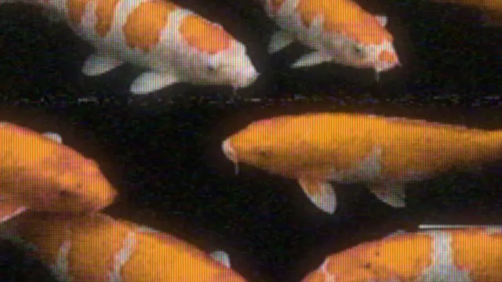

# VHS + CRT

**New to VHS and CRT looks?** VHS stored video on magnetic tape, and an old CRT television drew it
line by line with an electron beam on a glass tube coated with red, green and blue phosphors. Each
step left its mark. The tape kept little detail and even less color, so colors bleed to the right of
where they belong; it added grain, white specks and, when the heads drifted off the tracks on the
tape (mistracking), a band of torn lines and streaks. The cable that carried brightness and color on
one wire (composite video) left dots on colored edges and rainbows on fine detail. The tube showed its
lines, the pattern of its phosphors (the mask), a glow around bright parts and a curved face. Music
videos and VJ sets use the look for its warmth and its decay.

This effect models that signal instead of laying noise and scanlines over the picture. Each line is
read where the deck's unsteady time base puts it; it is filtered the way the deck's brightness
channel (to about 3 MHz) and color channel (to about half a megahertz) filter it, with filters that
smear only to the right, as analog ones do; the deck's own output filter and NTSC composite encoding
and decoding follow; then beams that widen as they brighten draw it through the mask. On the bars of
the music the heads lose tracking for a moment, and a drop slips the picture as a TV losing vertical
hold. Free VHS and CRT shaders for TouchDesigner exist, but none states a license, and they overlay
noise rather than model the signal; the one that models it (ntsc-td) is a Windows-only C++ plugin.
This one is MIT, runs on any GPU and follows the music.

The TV doesn't have to be a CRT. Screen also offers an LCD, a plasma panel and e-ink, each modeled from
how it works rather than imitated: the LCD's liquid crystal takes milliseconds to turn, so moving
things smear, and its tones shift with the angle it is seen from; the plasma makes each gray from a
frame's pulses of light, so an eye following a moving gradient adds up the wrong ones and sees false
bands; e-ink is ink, updating a few times a second and leaving ghosts until a full refresh, on the
bar, clears them with a black flash. See [The screens](#the-screens).

*Up close, one pixel to one: the phosphor stripes, the lines, the orange bleeding to the right.*

**[Download vhs_crt.tox](https://github.com/kevinraymond/touchdesigner-effects/releases/latest/download/vhs_crt.tox)**
· saved in TouchDesigner 2025.33230 (older builds may not open it) · works on the free
Non-Commercial license

## Use it

1. Drag `vhs_crt.tox` into your network. It shows TouchDesigner's sample movie (mist over a lake)
   as a worn tape on an old TV straight away, the tracking slipping every 2.5 s.
2. Wire any TOP into input 1. The result is on output 1, at the input's size.
3. Optional: wire audio or beat channels into input 2 (see Audio input): the tracking then slips on
   its bars.

Open Window (on the effect's page) shows it full size; Esc closes the window.

To update, delete your copy and drag in the new `vhs_crt.tox`. Dragging a `.tox` in embeds a copy,
so a new release doesn't reach it on its own. You can also point the COMP's External .tox at a
downloaded file.

## Parameters

The VHS + CRT page, top to bottom. Tape and Screen each switch their half off: Tape off is a clean
picture on the screen, Screen None is the tape on a flat screen. Each screen's own settings are grayed
out while another is chosen.

| Parameter | Default | What it does |
|---|---|---|
| Tape | On | Play the picture off a VHS tape: soft, colors bleeding, noise, a wobbly time base. Off: straight into the TV. |
| Tape Speed | SP | SP is the best a VHS tape gets; LP and EP fit more on a tape and keep less detail, so the picture is softer and the colors bleed further. |
| Wear | 0.4 | How worn the tape and the deck are, 0-1: grain, color noise, white specks trailing to the right, dropouts (white streaks where the tape lost its coating), the hue wandering line by line, lines wobbling sideways and the top of the frame bending. |
| Tracking | 0.2 | How far off the tracking is, 0-1: a band where the heads read between the tracks, torn sideways and full of white streaks, crawls up the picture. 0: none. |
| Head Switching | On | The last lines at the bottom pushed sideways, with a line of noise above them, where the deck switches from one head to the other. |
| Signal | Composite | How the picture reaches the TV. Composite: brightness and color on one wire, so colored edges show dots and fine detail turns into rainbows. S-Video: on two wires, no dots, the color still soft. RGB: as it is. |
| Lines | 240 | How many lines the picture has, top to bottom, on tape and on the screen (120 to 576). 240 is one field of NTSC, as old consoles drew it; 480 is finer. |
| Screen | CRT | What shows the picture: CRT, LCD, Plasma, E-Ink, or None (the signal, flat). See [The screens](#the-screens). |
| Mask | Aperture Grille | The pattern of the CRT's red, green and blue phosphors. Aperture Grille: fine stripes (Trinitron). Slot Mask: stripes broken into staggered slots (most TVs). Shadow Mask: dot triads (older sets, monitors). None. |
| Mask Size | 3 | Width of one red-green-blue triad of the CRT's mask, or of one pixel of the LCD or plasma panel, in pixels at 720 high; it scales with the picture, so it looks the same at any size (2 to 8). At 3, the LCD and the plasma have 240 rows of pixels, one for each of the tape's 240 lines. |
| Scanlines | 0.6 | How much the CRT's lines stand apart, 0-1. Dark lines are thin with black between them, bright lines wide enough to touch, as a CRT's beam grows with its brightness. The beam keeps the line's light, so the picture doesn't get darker. |
| Curvature | 0.3 | How much the CRT's glass bows, 0-1, with rounded corners and darker edges. 0: flat. |
| Glow | 0.3 | Light spreading in the glass around bright parts (halation), 0-1: the CRT's, or the plasma panel's front glass. |
| Response | 0.5 | How slowly the LCD's crystal follows, 0-1: 0 a later panel (a 4 ms step), 1 an early one (44 ms). Moving things leave trails, longest where cells turn lighter (behind dark things moving over light ones). |
| Viewing Angle | 0 | Where the LCD is seen from, -1 (well below) to 1 (well above). From above the picture washes out; from below it darkens and its light tones invert. At 0 the top is seen a little from below and the bottom from above, as on an old laptop. |
| Sub-Fields | 8 (Binary) | How the plasma makes each gray. 8 (Binary): pulses of 1, 2, 4 ... 128, as early panels did, with strong false contours where gradients move. 12 (Redundant): seven pulses of 32 for the upper grays, as later panels did: fainter. |
| Ink Mode | 4 Grays | How the e-ink panel updates, after E Ink's own modes. 16 Grays: about twice a second. 4 Grays: about three times a second. Fast: black and white, dithered, about eight times a second, at a little less contrast. |
| Ghosting | 0.5 | How much of what the e-ink panel showed stays behind after each update, 0-1. Where a pixel then holds still, its ghost stays, so ghosts pile up until a full refresh (each burst) clears them. |
| Bursts | On Bars | When the heads lose tracking for a moment: a big band of torn lines and streaks (on e-ink, a full refresh instead: black and back, the ghosts cleared). On Bars (the one of each bar) or On Beats follow input 2 (with nothing wired, every 2.5 s). Steady: every 2.5 s. Off: never. Flashing limits how often they come. |
| Length | 0.3 | How long a burst lasts, in seconds (0.1 to 1). |
| Song Moments | On | With Fosfora's signal on input 2: a build throws the tracking off further as it rises, and a drop slips the picture down a third of a frame for a moment (on e-ink, a full refresh). |
| Flashing | Calm | How often a burst, a drop's slip or an e-ink full refresh may come. Off: never, and no beat kicks either. Calm: at most once a second. Up to 3 per second: the WCAG 2.3.1 limit, which no setting exceeds. |
| Open Window | | Shows the picture in its own window, 1280 x 720 or filling a display. Esc closes it. |
| Full Screen | Off | Opens the window filling the whole display, for a projector or a second screen. |
| Display | 0 | Which display the window opens on; 0 is the primary display. |

The About page has Version, Built With (the TouchDesigner build it was saved in) and Open Docs.

## The screens

Every screen shows the same signal, the tape's (or, with Tape off, the clean picture's), and each is
modeled from how it makes light.

*Each screen recorded on its own with the music and tiled. Plasma's false contours need smooth
gradients in motion (skin, cloth, a sky in a pan); a silhouette has none.*

**CRT.** Each line is drawn by an electron beam whose spot widens as the line brightens, through the
phosphor mask; the glass glows around bright parts and bows at the corners.

**LCD.** Each pixel is three cells behind red, green and blue filters, inside a black matrix that
hides the wiring, lit from behind; a little light leaks through black, more toward the edges. The
liquid crystal in a cell turns by how far the drive voltage tells it to, over milliseconds. In a
twisted-nematic cell, the panels of the 1990s and 2000s, the voltage forces the crystal to block
light, but only its own elasticity turns it back to let light through, which is slower, and a small
step between two grays is slower still. So moving things smear, and the trails are longest behind
dark things moving over light ones. The light a TN cell passes also depends on the angle it is seen
from, up and down: from above, the picture washes out; from below, it darkens and its light tones
invert, darker than the middle ones, blue first, so it turns yellow-brown. Straight on, the top of the
panel is seen a little from below, so it is darker than the bottom, as on an old laptop.

**Plasma.** Each color of each pixel is a cell of gas that glows or doesn't, so a gray is made by
lighting it in some of the frame's sub-fields, pulses of 1, 2, 4 ... 128 units of light one after
another. A cell's light is linear, so the darkest grays have few steps, and the panel dithers them
(the shimmer in a plasma's shadows). A still picture looks right. But an eye that follows something
moving adds up each frame's pulses along its own path, from different cells, and where a moving
gradient crosses a value at which the code changes a lot (127 to 128: the pulses of 1 to 64 go off,
128 comes on), it sees light and dark bands that aren't in the picture. These are dynamic false
contours, the artifact plasma makers fought for a decade; here each sub-field is read where the eye is
when it lights, along the picture's own motion (optical flow). Later panels used more sub-fields with
repeated weights (12 (Redundant): seven pulses of 32), which leaves them much fainter. The green
phosphor glows on for about 10 ms after each pulse and the red a little less, while the blue stops
at once, so moving light things trail yellow and lead blue. The cells sit between ribs, and the front
glass glows.

**E-Ink.** Black and white particles in tiny capsules, pulled to the front or the back by the voltage
under each pixel and staying where they are left: gray paper and dark gray ink, with no light of its
own. Changing a pixel takes a waveform of pulses lasting a good fraction of a second, so video is a
run of updates, as fast as the mode allows (E Ink's modes: 16 grays about twice a second, 4 grays
about three times, black and white eight times, dithered). Each update drives only the pixels that
change, and never quite: some of the gray before stays behind, a ghost, carrying a share of the ghost
before it, and a pixel that doesn't change again keeps its ghost, so the ghosts of where things were
pile up. A full refresh takes every pixel to black and back and the picture returns clean; here it
comes with each burst, so on the music the ghosts pile up through a bar and clear on the one.

## Audio input

**[Fosfora](https://github.com/kevinraymond/fosfora)** gives the most. Run `fosfora --signal`, drag
`fosfora_signal.tox` (in Fosfora's `integrations/touchdesigner/`) into your project, and wire it
into input 2. Bursts follow its bars (or beats, Bursts), every beat kicks the lines sideways, and
with Song Moments on:

- **Builds:** as a build rises, the tracking drifts further off: the band grows and tears harder.
- **Drops:** a drop slips the picture down a third of a frame, the black bar between frames showing
  above it, and it snaps back after Length, through the same Flashing gate as every burst.
  Fosfora's drop detection is experimental.

Its level comes from Fosfora's `bass`, which swells with each beat and between passages.

**Any input:** bursts on its bars (On Bars) or beats (On Beats), a sideways kick of the lines on
every beat, and loudness raises the noise. Raw audio (an Audio File In or Audio Device In CHOP) gives
beats from a kick detector and a beat clock: once the kicks keep to a tempo, the clock locks to them,
beats then come on the beat even when a kick is missed, a kick between beats is left out, and a bar is
every 4 beats (which beat starts the bar is a guess). It stops 8 beats after the kicks do, and while
it isn't locked every kick is a beat. TouchDesigner's audioAnalysis gives beats from its kick or onset
channels.

On the library's test song (`dev/reaction.py`), the bars are what shows: in the half second after a
bar the picture is 1.54 times as far from the clip as in the half second before it (the burst).
Each beat's kick mostly hides in the tape's own noise: the picture changes 1.08 times as much in
the 0.2 s after a beat as before it. How much the picture changes follows loudness (correlation 0.86).

**Nothing wired:** a burst every 2.5 s, so the effect shows itself.

## Performance

60 fps at 1280 x 720 on the reference machine (MacBook Pro, Apple M2 Pro, 16 GB, macOS 15.6,
TouchDesigner 2025.33230), with default parameters (the CRT). Each frame took 1.9 ms on the GPU
(95th percentile 2.6 ms) and 0.37 ms on the CPU (95th percentile 0.45 ms), the median of three runs;
GPU times on this Mac swing by about a third from run to run (0.1.0 measured 2.9 ms). The tape's
filters cost the most (tape 0.7 ms, the deck's output filter 0.6 ms); they work on a raster 1280
samples wide and Lines tall whatever the picture's size, so they cost more with more Lines, not with a
bigger picture. The screen pass grows with the output.

The other screens, one run each: LCD 2.1 ms on the GPU (0.30 ms CPU), E-Ink 1.8 ms (0.41 ms), Plasma
3.8 ms (0.55 ms): its optical flow takes about 1.1 ms and reading every sub-field along the eye's path
1.2 ms. Only the chosen screen cooks, and nothing inside cooks while the output is unused.

## Accessibility

- **Flashing.** A burst is a flash, and so is a drop's slip. Both pass one gate that follows the
  Flashing parameter: Off never bursts, Calm (the default) allows at most one a second, and Up to 3
  per second is the WCAG 2.3.1 limit, which no setting exceeds. After the gate, a budget keeps this
  effect to about 2 a second even at Up to 3. Off also stops the kick on each beat.
- **No flicker of its own.** Tape noise changes every field, as it does on tape, but it is fine-grained
  and evens out over any area WCAG counts. A burst's torn lines and
  streaks hold still while it lasts. A drop slips the picture once and back, where a rolling picture
  would sweep light and dark past every point several times. The steady tracking band stays under a
  twelfth of the picture's height, below the area WCAG counts, and its tearing drifts rather than
  jumps. Broadcast NTSC turns its color subcarrier half a cycle every field, so composite dots crawl
  and rainbows flicker 30 times a second; here they hold still.
- **Red.** WCAG counts a pixel as saturated red once red is 80% of its light, all or nothing, so tape
  noise would make any red near that line flash, however faint the noise. Very saturated reds and
  oranges are kept a little short of it, on the picture and on every pixel of the mask: an orange
  comes out a little lighter. The effect made no red flashes at all in the tests below.
- **The other screens.** None adds a flash of its own: the LCD's smear and e-ink's updates only follow
  the picture (an e-ink update eases each pixel to its new gray over the update rather than jumping),
  and the plasma's shimmer is a fine dither. E-ink's full refresh, its one flash, is a burst's flash:
  black and back once, through the same gate and budget. The LCD's and plasma's cells keep their colors
  as soft as the CRT's mask, so the red guard holds on them too. Where plasma's false contours meet a
  noisy edge (the head-switching lines at the very bottom), a few small patches flicker faster, up to
  6.5 a second in one patch a sixty-fourth of the picture wide, far under the area WCAG counts.
- **No meaning in color.** Nothing is signaled by hue.

The flash rates were measured, not assumed. The test recorded the output while it fed a beat far
busier than music: 8 beats, 2 bars and 1 drop a second. The table gives the flashes in the worst
second, by WCAG's area rule:

| Clip | Off | Calm | Up to 3 per second | The clip alone |
|---|---|---|---|---|
| Dancer in a hazy warehouse | 1.0 | 1.0 | 1.5 | 1.0 |
| Dancer, a dance-tempo beat (140 BPM) | 1.0 | 1.0 | 1.0 | 1.0 |
| Dancer, no beat (steady bursts) | 1.0 | 1.0 | 1.0 | 1.0 |
| People crossing a plaza | 0.5 | 0.5 | 1.0 | 0.5 |
| Red flowers against the sky | 1.0 | 1.0 | 1.5 | 1.0 |
| Koi in a black pond | 1.0 | 1.0 | 1.5 | 0.5 |
| Red flowers, Wear 1, Tracking 1, EP | 1.0 | 2.0 | 2.5 | 1.0 |

Calm adds at most a flash a second even on the worst tape, and the bursts stay well under 3 at Up to
3 per second.

The other screens, measured the same way on 0.2.0 (the clip alone as above):

| Clip | Screen | Off | Calm | Up to 3 per second |
|---|---|---|---|---|
| Dancer in a hazy warehouse | LCD | 1.0 | 1.5 | 1.0 |
| | Plasma | 1.0 | 1.0 | 2.0 |
| | E-Ink | 1.0 | 1.0 | 2.0 |
| People crossing a plaza | LCD | 0.5 | 0.5 | 1.0 |
| | Plasma | 0.5 | 1.0 | 1.0 |
| | E-Ink | 0.0 | 1.0 | 2.0 |
| Red flowers against the sky | LCD | 1.0 | 1.5 | 1.5 |
| | Plasma | 1.0 | 1.5 | 1.5 |
| | E-Ink | 1.0 | 1.0 | 2.0 |
| Koi in a black pond | LCD | 1.0 | 1.0 | 1.5 |
| | Plasma | 0.5 | 1.5 | 1.5 |
| | E-Ink | 1.0 | 1.0 | 2.0 |

No red flashes on any screen. Each within its setting's rule: Off adds nothing to what the clip does
by itself, and Calm at most one a second. On the koi, Off measures 1.0 where the clip's brightness
measures 0.5, under the clip's own red flashing (1.5 a second), which is what the rule holds it to;
the CRT measured the same 1.0 there in 0.1.0. One version of e-ink failed
first and changed: it measured 2.0 at Off on the koi, from updates replayed when TouchDesigner's clock,
a 32-bit number in the shader, was too coarse after hours of running to tell two updates apart. Red flashes, which WCAG counts separately: none at any setting, on any clip (the
flowers by themselves make one a second and the koi one and a half; the guard takes those out too).
Two earlier versions failed these tests and changed: a roll on drops measured 3.5 flashes a second
at Up to 3, and the tape's noise made 2 red flashes a second on the flowers with Flashing Off (4 with
the screen off).

## Experimental

- Drop moments depend on Fosfora's drop detection, which is experimental.
- Beats from raw audio come from a kick detector and a beat clock that locks to the kicks' tempo. It
  takes a few beats to lock and can still add or miss beats where the kicks don't keep the beat, and
  which beat starts a bar is a guess; Fosfora or audioAnalysis give steadier beats.

## Credits and license

MIT. The shaders and operators are written for this library: the bursts, the slip, the red guard and
the screens' models among them.

- **The signal:** NTSC, the FCC's 1953 color standard (SMPTE 170M today): the YIQ matrix, the
  3.579545 MHz color subcarrier turning half a cycle each line, the 52.6 µs active line. VHS's
  published figures: luma to about 3 MHz (some 240 lines across a picture height), recorded as FM on
  a carrier from 3.4 to 4.4 MHz (hence the deck's steep filter at 3 MHz); chroma recorded below it
  ("color-under", 629 kHz) with about 500 kHz each side, about 40 lines.
- **The tape's passes:** their order and the causal (left-to-right) lowpass filters follow
  [ntsc-rs](https://github.com/valadaptive/ntsc-rs) by valadaptive (MIT, ISC or Apache-2.0), a port
  of [ntscqt](https://github.com/JargeZ/ntscqt) and [ntsc](https://github.com/zhuker/ntsc)
  (Apache-2.0), themselves after J. Campbell's
  [composite-video-simulator](https://github.com/joncampbell123/composite-video-simulator)
  (GPL-2.0). Read, not copied: no code taken, and the bandwidths here are VHS's published figures
  rather than ntsc-rs's cutoffs.
- **Composite decoding:** a notch filter for the brightness and synchronous demodulation for the
  color, the textbook NTSC receiver.
- **The tube:** Gaussian scanlines whose width grows with brightness, and phosphor masks, as CRT
  shaders have drawn them since cgwg's CRT-Geom (GPL) and
  [Timothy Lottes' scanline shader](https://github.com/libretro/glsl-shaders/blob/master/crt/shaders/crt-lottes.glsl)
  (public domain). Followed, not copied. The glow is the widely used mix of the blurred light
  (halation).
- **The LCD:** twisted-nematic response times, the voltage driving the crystal one way and its
  elasticity alone the other: E. Jakeman and E. P. Raynes, "Electro-optic response times in liquid
  crystals" (Physics Letters A 39(1), 1972). Gray-scale inversion and washout up and down, as
  twisted-nematic panels are widely described. The curves are written for this library and shaped by
  eye.
- **The plasma:** sub-field gray scale and dynamic false contours, the eye following motion summing
  the sub-fields: T. Yamaguchi, T. Masuda, A. Kohgami et al., "Degradation of moving-image quality in
  PDPs: dynamic false contours" (Journal of the SID 4(4), 1996). The 12-sub-field code with seven
  pulses of 32 is one of the redundant codes later panels used against them. Phosphor decay: green
  (Zn2SiO4:Mn) about 10 ms to a tenth, blue (BAM) 1 ms or less, from US patent 7,138,965 (plasma
  display phosphors); red's is assumed between them. The picture's motion is this library's
  Lucas-Kanade optical flow (B. D. Lucas and T. Kanade, 1981).
- **E-ink:** E Ink's waveform modes and their times as the IT8951 controller documents them (GL16 450
  ms, DU4 290 ms, A2 120 ms; A2 black and white at reduced contrast), ghosting and full refreshes. The
  ghost model is written for this library.
- **Dice:** Chris Wellons' lowbias32 integer hash ([hash-prospector](https://github.com/skeeto/hash-prospector), public domain).
- **Seen during the survey, not used:** tdx-crt, ntsc-td, BrokenVHS, TD-VHShader, CRT TV Filter.
- **Beats from raw audio** (the library's audio input, `lib/audio_callbacks.py`): a kick is a jump
  in the low band's loudness, and the beat clock takes its tempo from the gaps between kicks, each
  gap voting for the beat lengths it is a whole multiple of: inter-onset-interval tempo induction,
  the idea behind S. Dixon's "Automatic Extraction of Tempo and Beat from Expressive Performances"
  (Journal of New Music Research, 2001). Followed, not copied: written for this library.
- **Flash limits:** [WCAG 2.3.1](https://www.w3.org/WAI/WCAG22/Understanding/three-flashes-or-below-threshold.html), measured with this library's tools (`dev/flash.py`, `dev/flashcount.py`).

Preview footage: Kevin Raymond, touchdesigner-effects,
[CC BY 4.0](https://creativecommons.org/licenses/by/4.0/). It is AI-generated (see the
[repository README](../../README.md#demo-footage)) and shows no real person. The second preview is
a crop of the middle of the picture at one pixel to one, so the mask shows as it does on screen. The
third shows a dancer in silhouette (the same footage's source and license) on each screen.
